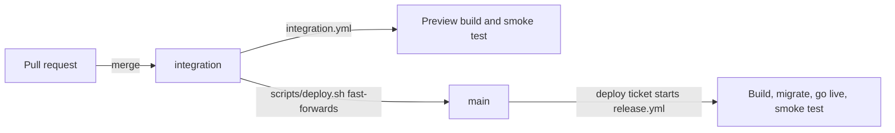

# project-buddy

project-buddy is a personal Next.js site where buddies help each user with their own projects and ideas, on any subject. Looking things up in the Blender manual is one of the buddies' skills. The [glossary](GLOSSARY.md) defines the site's words.

Before changing the code, read `AGENTS.md`, which links the rules for code, tests and production in [project practices](docs/project-practices.md). Remaining work is tracked in GitHub issues. The issue pipeline in the [ecosystem repository](https://github.com/axolotl-logic-io/ecosystem) works them; its docs are in that repository's `docs/` folder.

## Layout

The repo is a monorepo of npm workspaces with mise tasks:

- `apps/web/`: the site, a Next.js app. Everything below describes it, and its paths are relative to this folder.
- `apps/instruction-counter/`: a pi-backed text-file measurement tool that emits one JSON line; see its `README.md`.
- `docs/`: product scope, practices and operating notes, starting at `docs/README.md`.
- The root holds the shared tooling (`package.json` with the workspaces, the one `package-lock.json`, `mise.toml`, `biome.jsonc`) and the top-level docs (`AGENTS.md` and this README).

## Development

Node is pinned to 24 in the root `mise.toml`. Run `mise install` once, then use mise shell activation or prefix commands with `mise exec --`. Install every workspace's dependencies once, at the root, with `npm ci`.

From anywhere in the repo, mise runs the site's tasks:

```bash
mise //apps/web:check       # fast default: lint, types, shell checks, repository and Vite guards
mise //apps/web:test:vite   # focused subset: six default in-process Vite guards
mise //apps/web:test:browser # opt in: Chromium/WebKit integrations
mise //apps/web:test:integration # opt in: guards, Vite and every browser project
mise //apps/web:test:server # npm run test:server
mise //apps/web:test:e2e    # npm run test:e2e
mise //apps/web:build       # npm run build
mise //apps/web:dev         # npm run dev
mise //...:check            # check every app
```

Run the npm scripts in `apps/web/`, or add `--workspace apps/web` to run them from the root:

```bash
npm run dev          # start the dev server at http://localhost:3000
npm test             # fast default: repository/filesystem and six cheap Vite guards (Vitest)
npm run test:watch   # watch those same two guard projects
npm run test:vite    # focused subset: six default in-process Vite guards
npm run test:browser # opt in: browser integrations, including zones and touch
npm run test:integration # opt in: all guards, Vite and browser integrations
npm run test:server  # reset the test database and run the server tests (needs Docker)
npm run test:scripts # test workflow and lane shell scripts (fake curl/Docker, no network or database)
npm run test:e2e     # run the server tests, then build, start and run end-to-end tests (Playwright)
npm run lint         # lint with Biome; any warning fails the run
npm run typecheck    # type-check with tsc --noEmit
npm run format       # format with Biome (writes files)
npm run format:check # verify formatting without writing
npm run check        # fast default: Biome, typecheck, test:scripts, repository and Vite guards; stops at the first failure
npm run build        # production build
npm run db:generate  # generate SQL migrations in drizzle/ from src/db/tables/
npm run db:migrate   # apply migrations to the database at DATABASE_URL
npm run manual:reindex # rebuild the Blender manual search index at DATABASE_URL
```

[Biome](https://biomejs.dev) lints and formats the code; its settings are split across two files: the root `biome.jsonc` holds the policy for the whole repo, and `apps/web/biome.jsonc` extends it with the site's scoped overrides, whose globs are relative to `apps/web/`. `npx biome check` gives the same result at the root or in `apps/web/`. Tailwind class order is checked by the lint rule `useSortedClasses`, not by the formatter, so `npm run format` does not sort classes. To apply the sort, run `npx biome lint --write --unsafe --only=nursery/useSortedClasses`. The editor extension is listed in `.vscode/extensions.json`. Run `npm run check` before committing.

### Database

The app uses Neon Postgres through [Drizzle ORM](https://orm.drizzle.team) and the Neon serverless HTTP driver. Each feature defines its tables in `src/db/tables/`, which `drizzle.config.ts` names as the schema, and server code gets the client from `getDb()` in `src/db/client.ts`. Both the app and drizzle-kit read `DATABASE_URL`; see `.env.example`. Put it in `apps/web/.env.local`, which git ignores, or run `vercel env pull .env.local` in `apps/web/` once the Vercel project is linked. `.env.test`, which the e2e and server tests read, lives in `apps/web/` too: the orchestrator provides it with the database and site port pinned to the lane, or a developer runs `npm run test-env:init` (or copies `.env.test.example` by hand) for a manual run. `npm run db:generate` works without `DATABASE_URL`; `npm run db:migrate` needs it.

### Branches and deploys

Every pull request targets `integration`, not `main`. `main` is what production runs, and only `scripts/deploy.sh` moves it.



1. **A PR merges into `integration`.** The workflow `.github/workflows/integration.yml` builds the new head as a Vercel preview (`vercel deploy`, Preview environment variables) and runs the smoke test against it. It never migrates, because previews share the production database, so a preview of code that needs a pending migration may fail on the pages that read it. A failed preview opens or comments on an issue titled `Integration preview failed: <short sha>`, labelled `ops`. The workflow needs the repo secret `VERCEL_AUTOMATION_BYPASS_SECRET` to pass Vercel's Deployment Protection, as well as the release's Vercel secret and variables.
2. **`scripts/deploy.sh [--dry-run] [--yes] [<commit>]` releases a tested commit.** It takes the head of `integration` unless you name another commit on it, checks that its Integration preview passed and that `main` fast-forwards to it, lists what will ship, fast-forwards `main` (never a force-push), and opens a deploy ticket. A fix pushed straight to `main` must be merged back into `integration` first, or the script stops.
3. **The deploy ticket starts the release** described below.

Production is released, and migrated, by the GitHub Actions workflow `.github/workflows/release.yml`, never automatically. To release, run `scripts/deploy.sh`, or open a deploy ticket by hand: an issue labelled `deploy` (or add the label to an open issue). The workflow releases the head of `main`, comments the result on the ticket and closes it when the release passes its smoke test. Only someone with write access can start one. It builds on Vercel without going live (`vercel deploy --prod --skip-domain`), applies the pending migrations with `drizzle-kit migrate` while the previous build is still live, makes the new build live through Vercel's REST API (`.github/scripts/vercel-promote.sh`), and smoke-tests `https://project-buddy-rust.vercel.app` with `apps/web/scripts/release/smoke.ts`. Vercel's own Git deployments are off for every branch, previews included (`apps/web/vercel.json`), and no build migrates. The workflow needs the repo secrets `VERCEL_TOKEN` and `PRODUCTION_DATABASE_URL` and the repo variables `VERCEL_ORG_ID` and `VERCEL_PROJECT_ID`.

You can also run the Release workflow by hand (`workflow_dispatch`) from the Actions tab. When a step fails, the workflow opens an issue titled `Production release failed: <short sha>`, labelled `ops`, or comments on the one already open, and comments on the deploy ticket, which stays open. It names the failed step, the commit, the deployment and the run. If the build or the migration failed, production is still on the previous build; if going live or the smoke test failed, the new build may be live and is not working. A Vercel rollback (`vercel rollback`, or the dashboard) restores the previous code but never the schema.

### Chats

A project has many chats, and a user can also have standalone chats in no project. Each chat has one buddy, and at most one project, both fixed when it starts, and is in one activity at a time, which can change during the chat (`src/activities/`). Buddies and activities are prompts that the user can customize (`src/prompts/`). The signed-in `/chat` hub lists all owned chats and can filter them to an owned project; conversations, including standalone chats, open at `/chats/[chatId]`. See [Chats](docs/chats.md) for filtering, privacy and standalone-chat behavior. The tables live in `src/db/tables/projects-and-chats.ts`. `src/app/api/chat/route.ts` hands each new message to `replyToChat` in `src/replies/reply.ts`, which streams Claude's reply through the Vercel AI SDK and saves both messages. The model is chosen once in `src/replies/model.ts`, with the API key that `src/env.ts` reads from `ANTHROPIC_API_KEY`, and `src/replies/system-prompt.ts` builds the system prompt: the global prompt (`src/replies/global-prompt.ts`), the user's activities, the chat's project and memory, its current activity, and its buddy's voice and habits. Set `BUDDY_MODEL=mock` to use a deterministic mock model instead of Claude, as the tests do; see `.env.example`.

### Errors

`src/errors/app-error.ts` sorts every failure of a call to Anthropic or Neon into an `AppErrorCase`, such as `out-of-credits` or `database-unreachable`. The stores, the rate limits and `searchManual` run their queries through `withAppErrors`. The chat route passes model errors, including those that arrive mid-stream, to `toAppError`. `toAppError` logs the original error with its case, status, upstream message and request id, and this log line is what appears in the Vercel logs as `[app-error] <case> in <operation>`. The browser receives only the case and shows that case's fixed message, never the upstream text.

### Invitations and sign-in

Only admins can invite new accounts from `/invitations`, linked from their Account page. Migration 0013 provisions or promotes `me@modestprogress.com` as the initial admin without creating a session; the owner signs in normally to prove ownership. Other accounts keep their data and default to the ordinary `user` role. The admin role grants invitation administration only.

An invitation email opens `/setup`, showing the fixed normalized recipient address. Opening it is read-only; one confirmation atomically creates an ordinary account, consumes the invitation and signs that browser in. Invitations expire after 30 minutes, work on any device, and are single-use even under concurrent confirmation. Successfully sending a replacement invalidates the old link; failed delivery leaves the old link usable. Existing addresses get normal sign-in links instead. `/signup` explains invitations and can't accept the old shared code.

Existing users sign in by emailed link (`src/accounts/sign-in-links.ts`). Normal sign-in links remain reusable for 30 minutes, and only confirming the page sets an HTTP-only `session` cookie signed with `SESSION_SECRET`, valid for 30 days. `src/proxy.ts` admits `/login`, `/signup`, `/login/link`, and `/setup` without a session; other pages redirect to `/login`, and `/api/*` routes answer 401. Page and action authorization also checks the stored session epoch; invitation administration checks the stored role.

`src/accounts/rate-limits.ts` holds the limits, counted in the `rate_limits` table under the HMAC of each address, never the address itself. One connection (its first `x-forwarded-for` address) may ask for 3 links to one address in 15 minutes, and 20 links in an hour in all; one address gets at most 10 links in 15 minutes from every connection together. The page's answer is the same within or past a limit. Set `SESSION_SECRET`, `RESEND_API_KEY` and `EMAIL_FROM_ADDRESS` (the bare sender address, on a domain verified in Resend; email shows it under Hippy's name) in `.env.local` and in the Vercel project; see `.env.example`. Invitations and sign-in need `DATABASE_URL` too. Sign-up doesn't read the old `INVITE_CODE` setting.

### Manual index

The buddy's Blender manual lookup skill (`src/skills/blender-manual/`) searches the Blender Reference Manual through the `manual_sections` table. `npm run manual:reindex` makes a shallow `git clone` of the manual's latest stable release branch into a temporary directory, splits every RST file under `manual/` into one section per heading, and replaces the table's contents in one transaction. It reads `DATABASE_URL` from the environment or `.env.local`, and the table must already exist (`npm run db:migrate`). Each section links to `https://docs.blender.org/manual/en/latest/<path>.html#<anchor>`, with the anchor Sphinx gives the heading. `searchManual()` in `src/skills/blender-manual/search-manual.ts` queries the index.

When a new stable Blender release ships, set `MANUAL_BRANCH` in `src/skills/blender-manual/manual-source.ts` to its release branch, such as `blender-v5.4-release`, and run `npm run manual:reindex`.

The script runs under Node's built-in TypeScript support, so modules it imports use relative imports with a `.ts` extension instead of the `@/` alias.

### Tests

Tests live in `test/<level>/`, under the path their subject has: `component/` for isolated components, `component-integration/` for components with real dependencies, and `system/` for the built program with fake external services. Shared kits live in `test/support/`. `npm test` selects both Node projects: `repository` for filesystem guards in `**/*.test.{ts,mts}`, and `vite-integration` for the six restored in-process Vite guards. Server, browser and e2e tests remain excluded from the default. `npm run test:vite` selects just the six Vite guards; their retained focused run took 1.62 seconds together, so they stay in the fast default despite the integration label. Browser integrations, `test/**/*.browser.test.tsx`, run with Vitest in headless Chromium and WebKit through Playwright, explicitly selected by `npm run test:browser`. Browser-mode component integrations and feature-entrypoint tests are valid without a whole application flow. End-to-end tests live in `test/system/` as `*.spec.ts` and run with Playwright. Each runner ignores the other's directory. End-to-end tests cover only the auth workflows (`e2e-auth-only`), which `apps/web/test/component-integration/test/component-integration/use-cases/use-cases.test.ts` enforces against the auth cases in `apps/web/use-cases/auth-cases.ts`. Every other use case is tested in Vitest: by a server test against the test database if it needs a real server or database, and otherwise by a browser integration or feature-entrypoint test. Server tests are `test/**/*.server.test.ts`, run with Vitest in Node by `npm run test:server`, which needs Docker. It resets and migrates the local database configured in the supplied `.env.test` first and keeps the reusable database/proxy afterwards; `npm run test:e2e` runs them before Playwright, and `npm test` never does. They make their users, data and sessions with the kit in `test/support/test-database/`, described in `apps/web/AGENTS.md`.

Every test browser runs on the host; no test command starts Docker for browsers. `npm run test:browser` and `test:integration` first install the Playwright version's browsers if they are missing (`npm run browsers:install`), and the e2e tests use the same browsers. The fast default needs neither browsers nor `.env.test`. `npm run test:e2e` builds the site, checks the built font URLs and starts it on the configured `E2E_PORT`; it never reuses a server already running there.

The fast default keeps costly stages off by default, not deleted or skipped. `npm run check` keeps lint, types, deterministic shell safety checks and all repository guards, including the use-case guard, plus all six cheap Vite guards. A fast pass would not establish browser behavior, database isolation, build/font correctness or auth e2e behavior.

| Test selection | Cost and prerequisite |
| --- | --- |
| `npm test` / `npm run test:watch` | Default: repository plus Vite guards. The six Vite guards took 1.62 seconds together; no database, `.env.test` or browser binary. |
| `npm run test:vite` | Focused subset of the default, not a costly opt-in: those same six in-process Vite guards. |
| `npm run test:browser` (opt-in) | Chromium/WebKit on the host, with each zone and touch project; installs the browsers if they are missing. |
| `npm run test:integration` (opt-in) | Broad Vitest suite: guards, Vite and all browser instances; not server/e2e. |
| `npm run test:server` (opt-in) | Resets/migrates the supplied isolated database before testing. |
| `npm run test:e2e` (opt-in) | Server tests, production build/font check and Playwright; database, site port and Docker required. |

Keep timeout, concurrency, isolation, mock-model fences and assertions unchanged. Optimize retained slow-stage timing separately, or schedule these tasks in an explicitly authorized integration stage. Keep cheap guards in the default gate; do not mark unrun stages passed. The instruction counter's cheap fake-pi subprocess checks remain in its default gate; they make no real-model calls.

### Orchestrator-owned local tests

The orchestrator provides `apps/web/.env.test`, with `DATABASE_URL` and `E2E_PORT` pinned to its assigned lane. `apps/web/scripts/test-env/setup.sh` validates `ISSUE_PIPELINE_LANE_SLOT=K` (1–399), starts the shared Docker test server, provisions/reuses `pb-lane-K-neon-proxy` on `127.0.0.1:(24000+K)` and database `pb_lane_K`, and atomically publishes the file from the committed example with site port `20000+10K`. Existing lane data is not reset by setup. Without a slot, setup touches no container, database or `.env.test`.

Test commands only consume the supplied file. A missing `.env.test` is an error: no automatic copying, allocation or fallback to another database/port. Lane resources are reusable and are not torn down on a test command's exit. Separate active lanes have separate databases, proxies and ports; the orchestrator must not assign the same lane to independent concurrent runs. Build artifacts in one checkout are not isolated.

For a **manual run**, `npm run test-env:init` in `apps/web` writes `apps/web/.env.test` from the example with a database and site port derived from the worktree's path, one database per worktree, and keeps any `.env.test` already there. Or copy the example by hand and configure a local test database and an unused site port. From `apps/web`, run `npm run test-db:up` to start the local server, then `npm run test-db:reset` to create/migrate that configured database. Never share a manual database or port between simultaneous runs. Safety guards require localhost/127.0.0.1, safe database names (including `pb_lane_K`, never the server's own databases), the mock buddy and file email outbox.

- `npm run test:server` resets/migrates the supplied database, then runs Vitest server tests.
- `npm run test:playwright -- <file>` runs one e2e file **without server tests**, using that database and site port. For example: `npm run test:playwright -- test/system/sign-in.spec.ts`. Its database must already be migrated.
- `npm run test:e2e` runs `test:server` followed by `test:playwright` only on success, both with the same configured environment.
- `npm run test:scripts` includes deterministic lane tests using `fake-docker.sh` on PATH; no real Docker or database is used.

Explicit maintenance `scripts/test-env/prune.sh` requires `ISSUE_PIPELINE_LANE_SLOTS=N` (nonnegative whole count; zero prunes all identifiable lanes). It inventories the shared server before any removal and refuses uncertain inspection. Only canonical lane proxies/databases above N may be removed; retained issue resources and other namespaces are untouched. Names, shared container/network and port formulas live in `lanes.sh`. Do not run shared-server `test-db:down` while another checkout needs it.

**Keep one full web suite scheduled at a time until this change is accepted and operator setup is separately made compatible.** Merging repository scripts does not configure or install the pipeline's laneSlots, setup/prune/teardown wiring, nor authorize removal of retained resources. Operator setup remains separate. See [Project practices](docs/project-practices.md). Fix failures before rerunning; a flake is a failure.

### Phone and theme checks

A new page gets an entry in `PHONE_PAGES` in `apps/web/test/component-integration/app/phone-pages-test-kit.tsx`. The browser tests check every page at 320 and 390 px wide, with touch, in every theme, for sideways scrolling and touch targets smaller than 24 px (`npm run test:browser`).

A new theme gets an entry in `LONG_NAME_LENGTHS` in `apps/web/test/component-integration/themes/signed-in-pages.browser.test.tsx`. Theme contract and contrast tests check the token definitions and WCAG AA color pairs.
