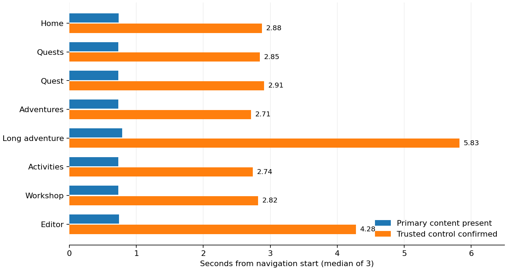

# Additional local measurements

These measurements address gaps identified in the first exploratory assessment. They use source `9a8ab46089fdbe8086efd2988a8cbc2e058b0e6c`, production build `eDoFyCX3Cc1n4DFG0OaCq`, containing #767's shared-header fix. They do not update integration or implement performance recommendations. The original measured build remains archived separately.

The directory name `current` distinguishes the additional capture cohort from the first baseline; it does not mean the latest integration source. Final reconciliation includes integration `1810793539c72b9703ec9a63275bda6a0dabd79f`. No measurements of that later revision or the final merged PR are claimed. Both recorded source/build identities remain unchanged.

## Conditions and reproduction

Use the same hardware, Chrome 156.0.8078.4, Puppeteer 24.12.1, desktop/phone CDP profiles and isolated local test environment described in the parent capture record. Reset only the worktree database with its guarded command. The fixture adds a third synthetic account with an empty quest and zero-message adventure; the original empty and populated account shapes remain unchanged.

The archived `recipes/prepare.sh.txt` copies the seed into `apps/web` temporarily, invokes existing test-data/session kits, removes that temporary file, and builds with the local mock/outbox environment. Build and font-delivery guard run under the host validation flock. Correct its absolute worktree path if reproducing elsewhere; use the provisioned worktree port throughout. Do not print environment or private session files.

Copy `start.mjs.txt` and `db-instrument.mjs.txt` into `/tmp/pb-773-current/` without `.txt`, then launch the start recipe from `apps/web`. It passes the worktree environment into the production server and preloads assessment-only local database transport instrumentation. The preload refuses non-loopback/non-worktree database URLs. It captures operation name `db.http`, timestamps, durations, HTTP status and byte counts only. It never records SQL, parameters, cookies, credentials, prompts or response bodies. Reading a cloned response adds overhead; browser measurements include that instrumentation overhead and are not an exact latency counterfactual to the original build.

Initialize `/tmp/pb-773-current/db-delay.json` to `{"delayMs":0}`. Copy browser/server recipes into the existing audit-tool directory. From the repository root, run each sequentially under `flock /tmp/project-buddy-unattended-full-suite.lock`. No new package or hosted service is added. Stop the server, remove the private session file and reset the guarded worktree database afterwards.

## Control and stability protocol

The fixed plan is three samples per populated journey/profile/cache-mode cell, and one per empty-list/empty-detail cell: 186 observations total. Desktop and phone each cover cold direct, warm direct and client navigation. Cold means a fresh browser context, not a reset database/server cache. Three samples support median and range, not population percentiles. Empty cells remain exploratory single observations.

Direct probes start at document commit, before waiting for DOMContentLoaded. The initial pilot waited for DOMContentLoaded, which could defer the probe until after hydration; that pilot was discarded. Its interrupted process emitted a detached-frame cleanup error and was not counted as a product failure or passing capture. Corrected captures retain only completed observations.

A trusted control action begins as soon as the route's primary surface exists. Home opens its shared menu; Quests changes a status tab and verifies selected state; quest, Adventures, Activities and Workshop open the adventure form; the adventure composer types a synthetic marker and verifies Send becomes enabled; the editor types a marker and verifies its local draft was persisted. These actions create no quest/adventure, submit no reply and save no definition. Native input values alone do not count as proof that React handled an edit.

Unconfirmed actions are sampled at a fixed 100 ms interval, with attempt counts retained. This is an explicitly sampled readiness experiment, not a behavior test rerun until passing. Report the first confirmed response as an upper bound with automation/probe-resolution overhead; do not call it the exact instant hydration completed. Home's native links may already work before its menu does. A missing control, non-2xx direct response, wrong signed-in path or unconfirmed action is a capture failure.

For direct loads, compute milestones from Navigation Timing's start (zero), including server wait. For transitions, compute from the observer reset immediately before route-link activation. The raw `origin` is observer initialization, so subtract it only for transitions. Source-page resource/paint metrics must not become destination metrics.

Observe for at least five seconds after observer initialization and at least two seconds after confirmed control response. Main/input rectangles use document coordinates (`rect.y + scrollY`); the raw root-header rectangle uses viewport coordinates. The root header is normal flow at this source, so its viewport Y follows scrolling. The reducer excludes that Y coordinate when identifying document-geometry changes; it retains header width/height/X and all raw scroll events. Retain geometry changes, all layout-shift source rectangles, Event Timing, long tasks and resource completion times. Report last observed document-geometry/shift change and whether a final 500 ms quiet interval exists. A finite quiet window establishes observed stabilization only; it does not prove a page never moves later. Modal opening, tab selection and typed input are deliberate interactions and remain identified in the record, rather than silently counted as unexplained loading shifts.

No screenshots are captured in this new matrix, so definition prompts cannot leak into frames. The original allowlisted synthetic Home/stream filmstrips remain available. New artifacts contain only static method/region names, route templates and numeric/boolean measurements; no input/prompt text is exported.

## Database-distance sensitivity experiment

The server recipe makes document-only authenticated requests, consuming each response without launching a browser. This excludes destination prefetch and client effects from the measurement window. It alternates zero and 50 ms extra delay per local database HTTP transport call across three samples per journey (48 document requests). The delay is synthetic, not measured production database distance.

Record client request-to-response-header and complete-document times, database HTTP call count, individual transport spans and their summed duration. Concurrent span sums can exceed the critical path and must not be treated as serial latency. This provides a causal local sensitivity experiment: the same code/data under a known additional dependency delay. It cannot assign query cost to auth versus a domain operation without more detailed server instrumentation, or claim that production has that latency. It is sufficient to test whether shared server dependencies can account for delayed shell/content when database distance grows.

## Capture corrections

The first completed groups exposed a duplicate-observer problem on client transitions: the document's original observer and a new transition observer both appended the same performance entry. `observer-checkpoint.json.gz` preserves that checkpoint. Only complete three-mode groups were retained; in-progress observations were not counted. Exact duplicate shift/long-task/LCP entries were removed by matching all retained fields, with their timestamps and source rectangles unchanged. These records carry `captureProtocol: commit-probe-v1-normalized`. Their Event Timing entries were not deduplicated because distinct target events can share exported fields; no event count/timing sum is inferred from those entries.

The corrected `commit-probe-v2` recipe disconnects prior observers before each transition. It also uses a new private marker for each input probe, so an editor's warm-cache persisted draft cannot falsely confirm a new edit. No editor probe had run before that correction. A column rectangle was added to the geometry sampler; earlier records still include complete shift-source rectangles, so their stable observation combines frame geometry and shift entries. The corrected recipe resumes only after complete groups and records these differences instead of silently pooling an invalid pilot. It expects the retained working `readiness.json` when resuming; initialize it to `[]` for a new run.

`server-streams.mjs.txt` adds body-transport milestones to the original document experiment: first response chunk, first root-header markup, first main markup and first textarea markup where present. These are transport availability markers, not paint or hydration readiness. It keeps only times and booleans; inspected HTML stays in process memory and is never exported. Its separate 48-request sample is not pooled silently with `server-paths.json`.

## Interpretation boundaries

Direct control times in the table include the navigation response wait; the progress log's provisional `ready` value subtracts observer initialization and must not be used as the direct-load metric. The reducer explicitly uses Navigation Timing start for direct loads. Resource entries in this supplemental capture include only requests starting after observer initialization; an earlier preload may be absent. Use the original comprehensive resource baseline and the new dependency experiment for byte attribution rather than treating these supplemental resource lists as complete transfer inventories.

The local transport preload adds response-clone and logging overhead. Its zero/50 ms conditions share that instrumentation, making the sensitivity experiment internally comparable. Header timing is not a server-work decomposition: streaming can flush headers before session/domain-dependent content completes. Synthetic 50 ms per-call delay is a recorded experimental input, not a claim that it reproduces the production database.

Input probes type a fresh `audit-` plus UUID marker (42 characters) before the state confirmation. Their control-completion upper bound therefore includes the typing action and persistence/rendering work, unlike the single-click menu/dialog/tab probes. Do not compare that difference as pure hydration latency. The same input protocol is used for zero-message and 200-message adventures, so that comparison controls action length. The Event Timing and long-task records help distinguish startup and interaction work, while the exact first useful keystroke may precede the final confirmation. A maintained audit can refine to continuous first-keystroke state observation; this assessment does not label the upper bound an exact hydration instant.

## Results and ownership

All 186 planned observations completed. Each populated cell has three samples; empty-list/detail cells have one. Every window records a final 500 ms quiet interval. The separate server experiments each completed 48 requests, three per route/latency condition. See [readiness and stabilization](readiness.md), [startup ordering](startup.md), [body-only dependency sensitivity](server-paths.md) and [stream transport milestones](server-streams.md).

The chart uses medians of three populated cold-phone samples. The input-action caveat above applies to adventure/editor bars. Shared startup is P1 in #796, while #795 owns remaining content-frame geometry, #794 owns operation-level server optimization experiments and #797 owns the maintained workflow. Physical devices, real-user percentiles and actual production database distance remain outside this local assessment.

## Validation and cleanup

The current validator (`recipes/check.py.txt`) reads the committed gzip baseline even when raw working JSON is absent. It checks all planned strata/repeat counts, unique cells, monotonic control milestones, observation windows, final quiet intervals, approved geometry regions, duplicate shifts, route identifier redaction and forbidden payload fields. It also checks both 48-request server cohorts and database-span consistency. Negative copies with a forbidden frame field and an unredacted identifier were rejected. The original trace validator still checks the Home/stream-only screenshot allowlist. JavaScript recipe syntax and whitespace checks pass.

The production build and font-delivery check passed for this capture source. No product behavior or test convention changed; the existing fast check and final-head CI from the fix round remain recorded separately. The local server was stopped, the private session file removed and the isolated worktree database reset after the additional captures. The new artifacts contain no screenshots or prompt text.

The root-header coordinate interpretation was checked against the measured CSS and scroll records: it is not a pinned header. An initial all-route invariant assertion about raw viewport Y was rejected because adventure focus scrolls the normal-flow header off screen. No artifact was changed to conceal that movement. The reducer ignores root-header viewport Y for document stabilization; desktop Home's unscrolled x/y/width/height remain exactly 0/0/1440/64. This correction does not alter readiness, shift sources or numeric captures.

For a fresh reproduction, create the output directory and initialize `readiness.json` to `[]` before starting the readiness recipe. For a resume, retain completed groups instead. Run the current validator before reducers; it creates `readiness.json.gz` from a raw working file and can validate the committed gzip with no raw file present. The reducers/chart recipe accept either form. Keep `observer-checkpoint.json.gz` as the audit record of the normalization described above; it is not an additional statistical cohort.
