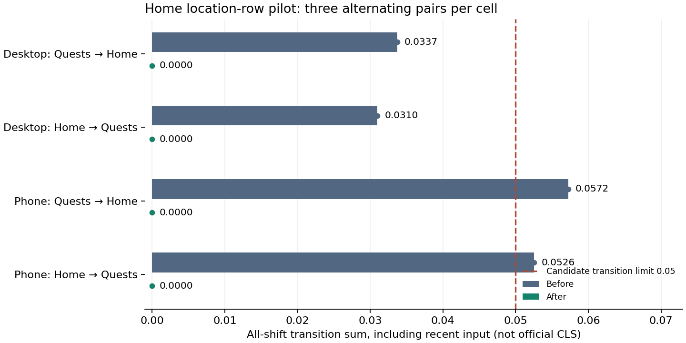

# Home trail pilot observations

This three-pair pilot compares the fresh fix-round build with the actual current-page Home breadcrumb alternative. It is isolated from final confirmation and does not establish final acceptance or post-Workshop-editor behavior.

Both variants use the same synthetic fixture, browser/profile, light theme, cache protocol, source preparation and observed-primary-presence +2 s window. Direct loads use fresh contexts. Client source preparation proves the visible menu opens/closes, and unchanged time origin proves a same-document transition. Warm direct loads are outside this cohort.

Initial-load session-window CLS excludes recent input. Transition all-shift sum includes recent-input shifts and is **not official CLS**. Values are median [min–max]; IQR is the descriptive interquartile range width. Candidate limits are direct ≤0.1 and transition ≤0.05. No observation is removed because it is an outlier or follows a click.

| Profile | Journey | Mode | Before n | Before | Before IQR | After n | After | After IQR | After within limit |
| --- | --- | --- | --- | --- | --- | --- | --- | --- | --- |
| desktop | home | client-navigation | 3 | 0.03370 [0.03370–0.03370] | 0.00000 | 3 | 0.00000 [0.00000–0.00000] | 0.00000 | 3/3 |
| desktop | quests | client-navigation | 3 | 0.03096 [0.03096–0.03096] | 0.00000 | 3 | 0.00000 [0.00000–0.00000] | 0.00000 | 3/3 |
| phone | home | client-navigation | 3 | 0.05723 [0.05723–0.05723] | 0.00000 | 3 | 0.00000 [0.00000–0.00000] | 0.00000 | 3/3 |
| phone | quests | client-navigation | 3 | 0.05256 [0.05256–0.05256] | 0.00000 | 3 | 0.00000 [0.00000–0.00000] | 0.00000 | 3/3 |

Each cell has tied values in this small pilot, so its observed min–max and IQR are zero-width. The figure shows medians only; it establishes no confidence interval or permanent stability.

## Paired differences

Differences are after minus before for the same sample number. Negative/zero/positive counts, IQR and ranges describe this finite matched cohort; they are not confidence intervals or population bounds. Zero observed spread does not establish no regression under other conditions.

| Profile | Journey | Mode | Pairs | Difference median [min–max] | Difference IQR | Negative / zero / positive |
| --- | --- | --- | --- | --- | --- | --- |
| desktop | home | client-navigation | 3 | -0.03370 [-0.03370–-0.03370] | 0.00000 | 3 / 0 / 0 |
| desktop | quests | client-navigation | 3 | -0.03096 [-0.03096–-0.03096] | 0.00000 | 3 / 0 / 0 |
| phone | home | client-navigation | 3 | -0.05723 [-0.05723–-0.05723] | 0.00000 | 3 / 0 / 0 |
| phone | quests | client-navigation | 3 | -0.05256 [-0.05256–-0.05256] | 0.00000 | 3 / 0 / 0 |

## Observed header geometry

Header samples must actually exist; absent data never passes as a zero-sized invariant. Width and height ranges include deliberate breadcrumb-row changes during transitions. They are not claims that the header stays the same size across routes.

| Variant | Profile | Journey | Mode | Header observed | Width range | Height range |
| --- | --- | --- | --- | --- | --- | --- |
| before | desktop | home | client-navigation | 3/3 | 1440–1440 | 60–112 |
| after | desktop | home | client-navigation | 3/3 | 1440–1440 | 112–112 |
| before | desktop | quests | client-navigation | 3/3 | 1440–1440 | 64–112 |
| after | desktop | quests | client-navigation | 3/3 | 1440–1440 | 112–112 |
| before | phone | home | client-navigation | 3/3 | 390–390 | 60–112 |
| after | phone | home | client-navigation | 3/3 | 390–390 | 112–112 |
| before | phone | quests | client-navigation | 3/3 | 390–390 | 64–112 |
| after | phone | quests | client-navigation | 3/3 | 390–390 | 112–112 |

## Outlier and uncertainty notes

The descriptive 1.5-IQR fence identifies samples for inspection; it is not a rejection rule. Small samples and tied values can make this fence sensitive to minor differences.

No observation lies outside its cell’s descriptive 1.5-IQR fence. This does not establish permanent stability or future no regression.

Capture failures retained: 0. One-minute host load across starts: 1.53–3.08.

These observations establish finite-window behavior for one synthetic fixture on this host, not field percentiles, interaction to next paint (INP), or permanent stability. Server/database caches are not reset between paired batches. Alternating pair order controls one simple ordering trend; it does not remove every host or scheduling effect.

Source rectangles retain raw viewport geometry and observer-delivery scroll offset; derived document coordinates during scrolling are approximate. Sampled regions use document coordinates. Activated-link geometry is recorded separately from affected rectangles. Column-node replacement is labelled separately from movement of the same node, and never removes any browser shift from the transition sum.
