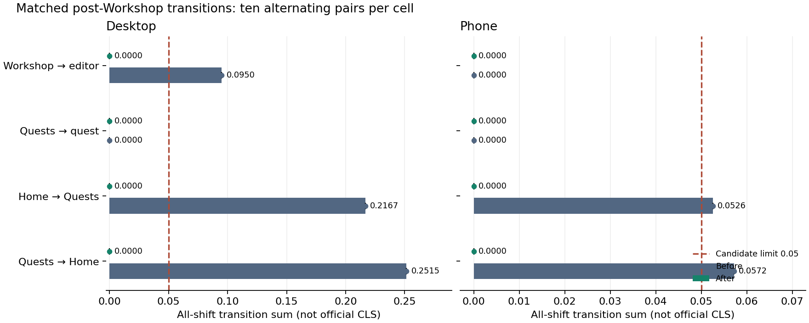

# Paired geometry observations

Both variants use the same synthetic fixture, browser/profile, light theme, cache protocol, source preparation and observed-primary-presence +2 s window. Direct loads use fresh contexts. Client source preparation proves the visible menu opens/closes, and unchanged time origin proves a same-document transition. Warm direct loads are outside this cohort.

Initial-load session-window CLS excludes recent input. Transition all-shift sum includes recent-input shifts and is **not official CLS**. Values are median [min–max]; IQR is the descriptive interquartile range width. Candidate limits are direct ≤0.1 and transition ≤0.05. No observation is removed because it is an outlier or follows a click.

| Profile | Journey | Mode | Before n | Before | Before IQR | After n | After | After IQR | After within limit |
| --- | --- | --- | --- | --- | --- | --- | --- | --- | --- |
| desktop | home | cold-direct | 10 | 0.21674 [0.00000–0.21674] | 0.21674 | 10 | 0.00000 [0.00000–0.00000] | 0.00000 | 10/10 |
| desktop | home | client-navigation | 10 | 0.25148 [0.25148–0.25148] | 0.00000 | 10 | 0.00000 [0.00000–0.00000] | 0.00000 | 10/10 |
| desktop | quests | cold-direct | 10 | 0.00000 [0.00000–0.00000] | 0.00000 | 10 | 0.00000 [0.00000–0.00000] | 0.00000 | 10/10 |
| desktop | quests | client-navigation | 10 | 0.21674 [0.21674–0.21674] | 0.00000 | 10 | 0.00000 [0.00000–0.00000] | 0.00000 | 10/10 |
| desktop | quest | cold-direct | 10 | 0.00000 [0.00000–0.00000] | 0.00000 | 10 | 0.00000 [0.00000–0.00000] | 0.00000 | 10/10 |
| desktop | quest | client-navigation | 10 | 0.00000 [0.00000–0.00000] | 0.00000 | 10 | 0.00000 [0.00000–0.00000] | 0.00000 | 10/10 |
| desktop | editor | cold-direct | 10 | 0.00000 [0.00000–0.09501] | 0.00000 | 10 | 0.00000 [0.00000–0.00000] | 0.00000 | 10/10 |
| desktop | editor | client-navigation | 10 | 0.09501 [0.09501–0.09501] | 0.00000 | 10 | 0.00000 [0.00000–0.00000] | 0.00000 | 10/10 |
| phone | home | cold-direct | 10 | 0.04671 [0.00000–0.04671] | 0.00000 | 10 | 0.00000 [0.00000–0.00000] | 0.00000 | 10/10 |
| phone | home | client-navigation | 10 | 0.05723 [0.05723–0.05723] | 0.00000 | 10 | 0.00000 [0.00000–0.00000] | 0.00000 | 10/10 |
| phone | quests | cold-direct | 10 | 0.00064 [0.00064–0.00064] | 0.00001 | 10 | 0.00064 [0.00064–0.00064] | 0.00000 | 10/10 |
| phone | quests | client-navigation | 10 | 0.05256 [0.05256–0.05256] | 0.00000 | 10 | 0.00000 [0.00000–0.00000] | 0.00000 | 10/10 |
| phone | quest | cold-direct | 10 | 0.00056 [0.00056–0.01076] | 0.00765 | 10 | 0.00056 [0.00056–0.00136] | 0.00060 | 10/10 |
| phone | quest | client-navigation | 10 | 0.00000 [0.00000–0.00000] | 0.00000 | 10 | 0.00000 [0.00000–0.00000] | 0.00000 | 10/10 |
| phone | editor | cold-direct | 10 | 0.00129 [0.00055–0.00129] | 0.00074 | 10 | 0.00055 [0.00055–0.00129] | 0.00000 | 10/10 |
| phone | editor | client-navigation | 10 | 0.00000 [0.00000–0.00000] | 0.00000 | 10 | 0.00000 [0.00000–0.00000] | 0.00000 | 10/10 |

## Paired differences

Differences are after minus before for the same sample number. Negative/zero/positive counts, IQR and ranges describe this finite matched cohort; they are not confidence intervals or population bounds. Zero observed spread does not establish no regression under other conditions.

| Profile | Journey | Mode | Pairs | Difference median [min–max] | Difference IQR | Negative / zero / positive |
| --- | --- | --- | --- | --- | --- | --- |
| desktop | home | cold-direct | 10 | -0.21674 [-0.21674–0.00000] | 0.21674 | 6 / 4 / 0 |
| desktop | home | client-navigation | 10 | -0.25148 [-0.25148–-0.25148] | 0.00000 | 10 / 0 / 0 |
| desktop | quests | cold-direct | 10 | 0.00000 [0.00000–0.00000] | 0.00000 | 0 / 10 / 0 |
| desktop | quests | client-navigation | 10 | -0.21674 [-0.21674–-0.21674] | 0.00000 | 10 / 0 / 0 |
| desktop | quest | cold-direct | 10 | 0.00000 [0.00000–0.00000] | 0.00000 | 0 / 10 / 0 |
| desktop | quest | client-navigation | 10 | 0.00000 [0.00000–0.00000] | 0.00000 | 0 / 10 / 0 |
| desktop | editor | cold-direct | 10 | 0.00000 [-0.09501–0.00000] | 0.00000 | 1 / 9 / 0 |
| desktop | editor | client-navigation | 10 | -0.09501 [-0.09501–-0.09501] | 0.00000 | 10 / 0 / 0 |
| phone | home | cold-direct | 10 | -0.04671 [-0.04671–0.00000] | 0.00000 | 8 / 2 / 0 |
| phone | home | client-navigation | 10 | -0.05723 [-0.05723–-0.05723] | 0.00000 | 10 / 0 / 0 |
| phone | quests | cold-direct | 10 | -0.00000 [-0.00001–0.00001] | 0.00001 | 5 / 3 / 2 |
| phone | quests | client-navigation | 10 | -0.05256 [-0.05256–-0.05256] | 0.00000 | 10 / 0 / 0 |
| phone | quest | cold-direct | 10 | 0.00000 [-0.01020–0.00080] | 0.00705 | 3 / 5 / 2 |
| phone | quest | client-navigation | 10 | 0.00000 [0.00000–0.00000] | 0.00000 | 0 / 10 / 0 |
| phone | editor | cold-direct | 10 | -0.00037 [-0.00074–0.00000] | 0.00074 | 5 / 5 / 0 |
| phone | editor | client-navigation | 10 | 0.00000 [0.00000–0.00000] | 0.00000 | 0 / 10 / 0 |

## Observed header geometry

Header samples must actually exist; absent data never passes as a zero-sized invariant. Width and height ranges include deliberate breadcrumb-row changes during transitions. They are not claims that the header stays the same size across routes.

| Variant | Profile | Journey | Mode | Header observed | Width range | Height range |
| --- | --- | --- | --- | --- | --- | --- |
| before | desktop | home | cold-direct | 10/10 | 1440–1440 | 64–64 |
| after | desktop | home | cold-direct | 10/10 | 1440–1440 | 112–112 |
| before | desktop | home | client-navigation | 10/10 | 1440–1440 | 60–112 |
| after | desktop | home | client-navigation | 10/10 | 1440–1440 | 112–112 |
| before | desktop | quests | cold-direct | 10/10 | 1440–1440 | 112–112 |
| after | desktop | quests | cold-direct | 10/10 | 1440–1440 | 112–112 |
| before | desktop | quests | client-navigation | 10/10 | 1440–1440 | 64–112 |
| after | desktop | quests | client-navigation | 10/10 | 1440–1440 | 112–112 |
| before | desktop | quest | cold-direct | 10/10 | 1440–1440 | 112–112 |
| after | desktop | quest | cold-direct | 10/10 | 1440–1440 | 112–112 |
| before | desktop | quest | client-navigation | 10/10 | 1440–1440 | 112–112 |
| after | desktop | quest | client-navigation | 10/10 | 1440–1440 | 112–112 |
| before | desktop | editor | cold-direct | 10/10 | 1440–1440 | 112–112 |
| after | desktop | editor | cold-direct | 10/10 | 1440–1440 | 112–112 |
| before | desktop | editor | client-navigation | 10/10 | 1440–1440 | 112–112 |
| after | desktop | editor | client-navigation | 10/10 | 1440–1440 | 112–112 |
| before | phone | home | cold-direct | 10/10 | 390–390 | 64–64 |
| after | phone | home | cold-direct | 10/10 | 390–390 | 112–112 |
| before | phone | home | client-navigation | 10/10 | 390–390 | 60–112 |
| after | phone | home | client-navigation | 10/10 | 390–390 | 112–112 |
| before | phone | quests | cold-direct | 10/10 | 390–390 | 112–112 |
| after | phone | quests | cold-direct | 10/10 | 390–390 | 112–112 |
| before | phone | quests | client-navigation | 10/10 | 390–390 | 64–112 |
| after | phone | quests | client-navigation | 10/10 | 390–390 | 112–112 |
| before | phone | quest | cold-direct | 10/10 | 390–390 | 112–112 |
| after | phone | quest | cold-direct | 10/10 | 390–390 | 112–112 |
| before | phone | quest | client-navigation | 10/10 | 390–390 | 112–112 |
| after | phone | quest | client-navigation | 10/10 | 390–390 | 112–112 |
| before | phone | editor | cold-direct | 10/10 | 390–390 | 112–112 |
| after | phone | editor | cold-direct | 10/10 | 390–390 | 112–112 |
| before | phone | editor | client-navigation | 10/10 | 390–390 | 112–112 |
| after | phone | editor | client-navigation | 10/10 | 390–390 | 112–112 |

## Direct-load all-shift diagnostics

These sums include recent-input entries, unlike the initial CLS column. They preserve visible movement even when the browser flags it as recent input. They are lab diagnostics, not an official metric.

| Variant | Profile | Journey | n | All-shift median [min–max] | Recent-input / total shift entries |
| --- | --- | --- | --- | --- | --- |
| before | desktop | home | 10 | 0.21674 [0.00000–0.21674] | 0 / 6 |
| after | desktop | home | 10 | 0.00000 [0.00000–0.00000] | 0 / 0 |
| before | desktop | quests | 10 | 0.00000 [0.00000–0.00000] | 0 / 0 |
| after | desktop | quests | 10 | 0.00000 [0.00000–0.00000] | 0 / 0 |
| before | desktop | quest | 10 | 0.00000 [0.00000–0.00000] | 0 / 0 |
| after | desktop | quest | 10 | 0.00000 [0.00000–0.00000] | 0 / 0 |
| before | desktop | editor | 10 | 0.00000 [0.00000–0.09501] | 0 / 1 |
| after | desktop | editor | 10 | 0.00000 [0.00000–0.00000] | 0 / 0 |
| before | phone | home | 10 | 0.04671 [0.04671–0.04671] | 2 / 10 |
| after | phone | home | 10 | 0.04671 [0.04671–0.04671] | 10 / 10 |
| before | phone | quests | 10 | 0.00064 [0.00064–0.00064] | 5 / 20 |
| after | phone | quests | 10 | 0.00064 [0.00064–0.00064] | 8 / 20 |
| before | phone | quest | 10 | 0.01076 [0.01076–0.01076] | 7 / 20 |
| after | phone | quest | 10 | 0.00136 [0.00136–0.00136] | 7 / 20 |
| before | phone | editor | 10 | 0.00129 [0.00129–0.00129] | 4 / 20 |
| after | phone | editor | 10 | 0.00129 [0.00129–0.00129] | 9 / 20 |

## Outlier and uncertainty notes

The descriptive 1.5-IQR fence identifies samples for inspection; it is not a rejection rule. Small samples and tied values can make this fence sensitive to minor differences.
- before, desktop, editor, cold-direct, sample 5: 0.09501399; affected source tags {'DIV': 1}; host one-minute load 1.23. Retained in every summary. Source rectangles identify the movement; this load value does not establish a cause.
- before, phone, home, cold-direct, sample 2: 0.00000000; affected source tags {'FOOTER': 1, 'A': 1, 'unknown': 2, 'SPAN': 1}; host one-minute load 2.43. Retained in every summary. Source rectangles identify the movement; this load value does not establish a cause.
- before, phone, home, cold-direct, sample 4: 0.00000000; affected source tags {'FOOTER': 1, 'A': 1, 'unknown': 2, 'SPAN': 1}; host one-minute load 1.70. Retained in every summary. Source rectangles identify the movement; this load value does not establish a cause.
- after, phone, quests, cold-direct, sample 9: 0.00064293; affected source tags {'unknown': 6, 'SPAN': 1}; host one-minute load 2.19. Retained in every summary. Source rectangles identify the movement; this load value does not establish a cause.
- after, phone, quests, cold-direct, sample 10: 0.00064293; affected source tags {'unknown': 6, 'SPAN': 1}; host one-minute load 1.38. Retained in every summary. Source rectangles identify the movement; this load value does not establish a cause.
- after, phone, editor, cold-direct, sample 7: 0.00129055; affected source tags {'BUTTON': 3, 'LI': 1, 'unknown': 4}; host one-minute load 1.30. Retained in every summary. Source rectangles identify the movement; this load value does not establish a cause.

Capture failures retained: 0. One-minute host load across starts: 0.81–4.21.

These observations establish finite-window behavior for one synthetic fixture on this host, not field percentiles, interaction to next paint (INP), or permanent stability. Server/database caches are not reset between paired batches. Alternating pair order controls one simple ordering trend; it does not remove every host or scheduling effect.

Source rectangles retain raw viewport geometry and observer-delivery scroll offset; derived document coordinates during scrolling are approximate. Sampled regions use document coordinates. Activated-link geometry is recorded separately from affected rectangles. Column-node replacement is labelled separately from movement of the same node, and never removes any browser shift from the transition sum.

## Source inspection of retained variation

Desktop editor before cold sample 5 changes its column DIV from x=336, width=768 to x=134, width=1172 at unchanged y=112 (0.09501399). The other nine before cold samples record no shift; a fast load can avoid a visible fallback. All ten before editor client samples move, while after cold/client samples do not. This supports ancestor-width attribution without claiming every before cold load moves.

Phone Home cold samples all contain the same inclusive 0.04671467 movement in both variants. Its footer moves from y=696 to y=752 and its Continue link changes from an inline rectangle (x=239, y=610, width=116) to a row (x=34, y=674, width=322), alongside text rectangles. Before samples 2/4 and every after sample have the browser recent-input flag, explaining the apparent initial-metric improvement without an actual movement reduction. No direct-load control is intentionally clicked. The flag is not proof of deliberate input; responsive/font settlement is plausible but not established.

After phone Quests cold samples 9/10 are 0.00064293 versus approximately 0.00063675 in the other eight. The narrow tied IQR fence highlights a real but tiny glyph/text-rectangle difference (about 0.00000618), not a meaningful claim of categorical stability. After phone editor cold sample 7 includes two non-recent-input text/button entries (0.00073901 and 0.00055154), while the other samples exclude the first through the browser flag. Button/list/text widths vary by a few pixels rather than the ancestor frame expanding. No font cause is proven. All entries remain in the inclusive table.

Two positive paired initial-metric differences each remain in phone Quests and quest cells. They are below the candidate limits and are not hidden by the median. No statistical no-regression conclusion follows from ten observations.

