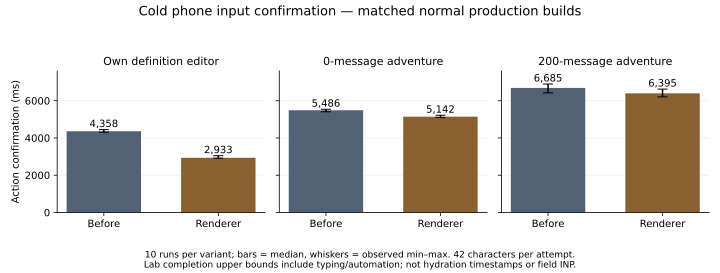

# Adventure and editor client work

Issue [#796](https://github.com/axolotl-logic-io/project-buddy/issues/796) follows the [#773 assessment](../773/README.md). The supported renderer change reduces cold editor blocking work and editor JavaScript transfer. It does not resolve shared cold startup or the long-adventure responsiveness target. The normal production comparison contains 132 observations, with ten cold confirmations per variant for the editor and 0/200-message adventures. All three-run cells and failures remain available.

## Sources and delivery

| Variant | Source | Normal production build |
| --- | --- | --- |
| Before | `bb4d213c24c0e7c0d8930f96581b0cba7763da37` | `49iPP5noQxeZGWd96H5TE` |
| Renderer | `e99e266d4410adb9b596a909df55f325dce64ddd` | `wZMt37C0myB-rkIq1iLn9` |

The baseline includes the twenty integration PRs through #806. The older measured sources `242e3a1` and `9a8ab46` supply historical context only. These measurements describe this pair, not later integration, the Focus + Drawer Workshop branch, or a production release. The [manifest](manifest.json) records build and protocol provenance.

The optional code-highlighting engine loads when code needs it. Plain code remains readable while the engine loads, and cached highlighting retains its synchronous behavior. Language metadata and theme tokens remain synchronous. Markdown uses stable heading maps and memoization. The complete adventure history stays eager; a memoized presentation component separates it from composer updates.

Definition previews and the Workshop load their Markdown module through Next's documented dynamic import boundary.

There is no React profiling build in this comparison, so neither React render counts nor React-specific CPU attribution is claimed.

Every historical message remains in the document. Essential editing and Send controls retain their ownership and session rules. Image dimensions, font hints, draft persistence, provider independence, preference freshness and reply accounting remain intact. No hosted telemetry, new service, schema rename or purchase activation is added.

## Matched phone protocol

Both variants use the same synthetic accounts, own definition, and 0/20/200-message adventures. The 20-message case includes Markdown, Python code, a loaded public image and a milestone tool result; capture asserts those cases are present. The 200-message fixture contains plain alternating questions and answers. Controlled replies use separate 200-message fixtures and the existing mock-model safeguards.

The applied phone profile uses Chrome 156.0.8078.4, Puppeteer 24.12.1, a 390 × 844 touch/mobile viewport, device scale 1, Parchment Light, 4× CPU slowdown, 150 ms network latency, download 200,000 bytes/s and upload 93,750 bytes/s. Host load averages accompany every observation. All build, check, browser, server and expensive capture stages serialize through `/tmp/project-buddy-unattended-full-suite.lock`; accounts, database, builds and port are isolated. Host-load ranges are in [summary.json](summary.json). This is emulation on a shared 32-logical-CPU host, not a physical phone.

Cold loads use fresh browser contexts. Warm direct loads reuse the context and target cache. Client transitions first confirm the source page's shared menu opens, close it with Escape, reset observers and activate the same destination link. Capture requires unchanged `performance.timeOrigin`; a native full load fails. Alternating order is before/renderer for odd pairs and renderer/before for even pairs. The initial matrix has three independent runs of five journeys in all three modes. Seven additional cold pairs extend the editor and 0/200-message cases to ten.

Home uses a single menu click. Input probes type a fresh 42-character marker **per attempt**, then confirm Send enabled or a persisted editor draft. A fixed 100 ms lab sampling interval separates attempts; all attempts remain recorded. Completion includes typing, state updates, automation and sampling. It is an upper bound on successful action completion, not an exact hydration timestamp or pure input delay. Earlier #773 source preparation differs and is not pooled.

Raw observation continues for at least five seconds after observer initialization and two seconds after confirmation. Fixed-window task and resource comparisons use the **same first five seconds**: navigation start for direct loads, observer reset before activation for transitions. Long tasks contribute only their overlap with that window. This is occupied long-task time, not Lighthouse total blocking time (TBT).

Keyboard values are the largest recorded keyboard Event Timing duration per run, including presentation delay; events below the 16 ms reporting threshold can be absent. They are not field interaction to next paint (INP).

Medians and observed min–max ranges express these small samples; no percentile or population no-regression claim follows.

## Cold confirmations

Values are median [min–max], in milliseconds. Each row has ten runs per variant.

| Journey | Before input confirmation | Renderer input confirmation | Before five-second long tasks | Renderer five-second long tasks |
| --- | --- | --- | --- | --- |
| Own definition editor | 4,358 [4,308–4,449] | 2,933 [2,914–3,045] | 442 [424–461] | 286 [277–305] |
| Empty adventure | 5,486 [5,406–5,543] | 5,142 [5,094–5,219] | 459 [437–488] | 433 [427–453] |
| 200-message adventure | 6,685 [6,418–6,896] | 6,395 [6,207–6,624] | 492 [456–597] | 656 [599–688] |

The editor improves input confirmation by 32.7% and occupied long-task time by 35.2%. The 200-message confirmation improves only 4.3%. Its five-second long-task sum increases: moving work into an earlier fixed window cannot be counted as a blocking-work reduction. The empty adventure remains slow despite having no history. Shared adventure bootstrap remains a priority beyond this delivery.

The editor's per-run worst keyboard duration changes from 168 [144–192] to 140 [128–160] ms. The 200-message case changes from 528 [496–576] to 512 [504–536] ms. These matched results do not meet a 20% keyboard reduction or the proposed 275 ms ceiling for the long adventure. Historical exploratory 344 ms events used another capture and are not a matched baseline.

Cold primary-content proxies remain essentially unchanged: editor 744→745 ms, empty adventure 733→733 ms and 200-message adventure 1,141→1,148 ms. Home's three-run click confirmation is 2,813 [2,809–2,850]→2,859 [2,850–2,866] ms. The 20% content-proxy and 2,300 ms cold Home budgets are unmet. The editor meets the proposed 3,424 ms cold input ceiling; the long adventure misses 4,661 ms.

## Warm and transition results

These are screening cells with three runs per variant, not ten-run confirmations. Values are action confirmation in milliseconds; input cells include the same 42-character probe.

| Journey | Warm direct before→renderer | Client transition before→renderer |
| --- | --- | --- |
| Home menu | 648 [648–660]→657 [635–665] | 604 [600–607]→604 [598–609] |
| Own definition editor | 876 [862–887]→860 [831–887] | 665 [658–928]→937 [904–1,144] |
| Empty adventure | 900 [873–914]→916 [912–992] | 727 [690–992]→726 [693–739] |
| 20-message mixed adventure | 1,087 [1,067–1,177]→1,065 [1,026–1,149] | 962 [939–972]→932 [930–1,020] |
| 200-message adventure | 1,880 [1,782–1,918]→1,887 [1,784–1,943] | 1,791 [1,778–1,828]→1,707 [1,698–1,830] |

The editor transition is slower in this screen, although both medians remain under 1,500 ms. Its primary proxy also changes from 370 to 643 ms. This tradeoff stays visible; the cold result does not establish a universal navigation improvement. The long adventure misses the warm/client input ceiling. Complete content, keyboard, task, byte and shift summaries for every cell are in [summary.json](summary.json) and [matrix.csv](matrix.csv).

## Bytes and request attribution

Resource Timing transfer sizes and Chrome DevTools Protocol (CDP) encoded lengths are separate counters. Requests must start **and complete** inside the fixed window to contribute to completed-window totals. Source prefetch stays separate from destination requests, and known prefetch flags come from headers classified only in memory. Exported request records contain categorical paths and static operation names, never raw URLs, identifiers, headers or action hashes. A late unmarked script is not automatically classified as either critical or prefetch.

| Cold route | Early-started `script`-type bytes before→renderer | Completed five-second `script`-type bytes before→renderer |
| --- | --- | --- |
| Home, three runs | 192,083→192,083 | 277,678 [255,371–277,678]→255,371 |
| Editor, ten runs | 430,574→209,935 | 430,574→249,235 |
| 0/200-message adventures, ten runs | 630,554→578,973 | 643,500→591,919 |
| Mixed 20-message adventure, three runs | 630,554→578,973 | 643,500→591,919 (deferral only) |

These columns count Resource Timing `initiatorType=script` entries, including parser-loaded script tags; this category differs from CDP initiator classification.

“Early-started” means script requests started by the primary-content proxy, with their eventual recorded transfer size; it is a descriptive loading cohort, not a complete critical-path model. CDP parser-initiated script bytes independently remain 195,727 on Home in all six observations. Home's varying late 22,307-byte chunk explains why the five-second total cannot support an initial-load reduction claim. Fonts remain 131,368 completed bytes per cold observation. Cached warm cells reporting zero transferred script/font bytes do not imply zero parsing or execution.

The mixed row does **not** show a total JavaScript reduction. In every renderer cold code run (3/3 main and 10/10 independently prewarmed), the separate 51,716-byte highlighting engine and 1,868-byte companion chunk load after five seconds; the 9,519-byte Python grammar follows. The engine starts at 5,909–5,989 ms in the main cohort and 5,876–6,055 ms in confirmation. Main-cohort Python grammar completion is 6,468 [6,424–6,476]→6,655 [6,649–6,739] ms; the separate confirmation is 6,403 [6,327–6,536]→6,711 [6,618–6,803] ms. The engine moves out of the early phase, but code still needs it, and grammar completion is later.

Whole-observation Resource Timing script transfer is below. These totals include all completed `/_next/static/:asset.js` entries, including the 2,340-byte `link` preload excluded from the earlier script-initiated counters. The reducer retains both definitions as `wholeObservedScriptBytes` and `wholeObservedScriptInitiatedBytes`. Windows start at navigation start and end at each recorded observation end; ranges below are seconds, rounded to three decimals. These variable-window totals describe recorded transfer, not matched-window budgets, complete future traffic, blocking work or critical-path improvement.

| Cold cohort | Runs per variant | Whole-observation script bytes before→renderer (median) | Before window range (s) | Renderer window range (s) |
| --- | --- | --- | --- | --- |
| Main Home screen | 3 | 280,018→280,018 | 5.169–5.171 | 5.173–5.179 |
| Main editor screen | 3 | 472,214→251,575 | 6.312–6.348 | 5.170–5.171 |
| Main empty adventure screen | 3 | 645,840→594,259 | 7.410–7.463 | 7.103–7.159 |
| Main 200-message screen | 3 | 645,840→594,259 | 8.422–8.794 | 8.316–8.395 |
| Main mixed 20-message screen | 3 | 656,325→658,328 | 8.119–8.156 | 7.792–7.870 |
| Editor cold confirmation | 10 | 472,214→251,575 | 6.312–6.453 | 5.170–5.175 |
| Empty adventure cold confirmation | 10 | 645,840→594,259 | 7.410–7.550 | 7.103–7.224 |
| 200-message cold confirmation | 10 | 645,840→594,259 | 8.422–8.901 | 8.211–8.630 |
| Separate mixed prewarm confirmation | 10 | 656,325→658,328 | 8.013–8.207 | 7.767–7.938 |

Each byte total is constant across its cell's runs. Main screens and their cold confirmations overlap; they are not independent cohorts to add together. The renderer editor and 0/200-message routes request no separate engine or Python grammar in these observations and have lower whole-observation bytes. Both mixed cohorts instead increase by **2,003 bytes**: the rich-code total-byte no-increase target is unmet.

The lower completed-five-second mixed total establishes deferral within that fixed window only. The summary and CSV retain window ranges, whole-observation totals and separate engine/companion/grammar counts and timings for every main and confirmation cell; chunk counts use this archived build pair's byte signatures. Zero separate baseline engine chunks does not mean the embedded baseline lacked highlighting.

The CSS-initiated `/atlas/parchment.webp` remains artwork, not stylesheet bytes. Its file is unchanged. A separate HTTP diagnostic on rejected build `JLzEzXFUTd2K1RsxrnLOq` returned a 783,806-byte body; #773's 784,106-byte value included transfer overhead. In the main Home screen its request starts near 0.62 seconds but is still in flight when observation ends near 5.17 seconds. Zero completed bytes therefore does not mean zero transfer.

The separate ten-second Home cohort records three runs per variant: Resource Timing reports exactly 784,106 artwork bytes in all six, while CDP encoded length reports 784,484. Completion is 6,903 [6,889–6,910]→6,911 [6,908–6,911] ms. These are two different accounting APIs, with no artwork-byte reduction. Its longer window is not pooled into the main matrix.

No font or artwork loading change is justified by the renderer experiment.

Operation classification observes one preference-refresh POST on each direct Home/editor load and one preference-refresh plus two reply-accounting POSTs on adventures. Source inspection finds that `RefreshPreferences` authenticates on navigation and tab return, updates the hidden-extras cookie and requests refreshed data. `ChatView` separately reads accounting when its ready conversation changes, including refreshed initial messages. Count alone does not establish redundancy. This PR changes neither freshness nor accounting acknowledgements; #794 owns server-operation spans.

## Supplemental mixed and Lighthouse screens

The mixed 20-message case also has a separate ten-pair confirmation cohort. It prewarms authenticated Home/plain-adventure/editor/empty documents on the local server, then uses a fresh cold browser context. That server preparation differs from the main matrix, so the cohorts are not pooled.

Input confirmation is 6,082 [6,006–6,202]→5,843 [5,764–5,935] ms. Per-run worst keyboard Event Timing is 184 [168–224]→188 [176–400] ms. The renderer's 400 ms event remains in the report; a faster median action does not clear the keyboard target.

The mixed cohort's five-second occupied long-task median increases in both protocols: **169→422 ms** in the main three-run screen and **208.5→425 ms** in the separate ten-run confirmation. A roughly 270 ms task moves from around 4.99 seconds to around 4.70 seconds, crossing the window boundary; the raw task timelines remain unchanged. For example, confirmation sample one records 275 ms starting at 4,987.4 ms before and 265 ms starting at 4,673.9 ms after. Whole-observation sums are 770 [757–771]→725 [709–726] ms in the main screen and 768.5 [708–822]→732.5 [704–892] ms in confirmation, over the differing windows listed above. As with the 200-message row, work moving into the fixed window cannot count as a blocking-work reduction, and selecting the more favorable whole window does not establish a gain.

A separate warm Lighthouse 12.8.2 simulated-mobile profile reuses the #773 recipe with authenticated target prewarming and `disableStorageReset`. Three alternating pairs give median TBT 122 [108–186]→120 [107–165] ms, with no runtime errors or warnings. Both new medians are below the historical 358 ms candidate ceiling.

The earlier 448 ms number used another build/fixture and is not the matched comparator here. This small screen shows no material reduction, is not a ten-run budget confirmation, and is not pooled with the applied CDP phone profile or treated as field INP. [lighthouse.json.gz](lighthouse.json.gz) retains settings and numeric audits without page snippets or screenshots.

## Main-thread and shift evidence

Separate stripped DevTools cold traces contain one 200-message observation per variant, outside the normal matrix. Over the first eight seconds, interval-union script coverage is 2,582→2,631 ms; layout/style is 417→448 ms and paint/prepaint is 340→354 ms. These categories overlap, include capture/probe work, and must not be added as serial CPU or treated as a repeated-run estimate. The active renderer is selected from recorded renderer threads by most event dispatches. Trace events support substantial scripting plus layout work; they do not establish that React hydration caused an individual task. [attribution.json](attribution.json) and its recipe retain the calculation.

All shift records retain `recentInput`, source tags and old/new rectangles. The empty-adventure five-second all-shift median changes from 0.000728 to 0.033784 because the same 260-pixel composer expansion crosses the five-second boundary: one baseline example occurs at 5,037 ms, renderer at 4,732 ms. Document scroll remains unchanged in that example. The interaction-inclusive sum is not CLS. Initial session-window CLS, excluding recent-input shifts, is zero in these actively probed samples; that does not establish absence of loading shifts.

Small font-correlated shifts remain in the raw records, and causation is unproven. Stable route geometry belongs to #795.

## History alternatives and controlled streams

Three replies per variant use the same synthetic eight-second delayed mock stream in separate 200-message adventures. Complete history and following are checked separately from cold startup. Sample two uses native PageUp and waits for `scrollend` to read earlier history. A supplemental run tracks the same visible recent-history message in viewport coordinates through completion, rather than equating document `scrollY` with reading position.

The three mock replies complete at 9,061 [8,998–9,090] ms before and 9,090 [9,088–9,106] ms after, including the configured eight-second delay. All six preserve 202 messages and access to the first question. Whole-observation long-task sums are 1,055 [971–1,070]→1,059 [1,058–1,081] ms; completion-dependent windows are retained, so these are descriptive stream observations rather than a fixed-window startup or provider-latency improvement. Maximum individual tasks are 342 [298–343]→340 [336–346] ms.

The supplemental visible-message anchor is index 199, the newest message in the original 200-message history. Its viewport-top change is exactly 0 pixels in both variants. Its document Y changes by −76 pixels as the Stop control above the history disappears; height and index stay unchanged. This establishes recent-history preservation for that sample, not deep-history preservation or every scroll scenario.

The original #773 menu anomaly remains unattributed. This diagnostic opens the shared menu programmatically at the document bottom; it preserves the recorded scroll position in both builds. It does not reproduce a trusted touch interaction, so it cannot clear that anomaly or prove the overflow rule caused it. No menu or scroll production code changes here. The existing browser kit separately exercises trusted scroll/focus and #771 following behavior.

Two dynamic history designs were rejected. Per-message Markdown boundaries produced one 12,841 ms cold confirmation versus a 6,497 ms baseline pilot. A single history-level boundary still produced 12,440 ms and a 6,392 ms keyboard Event Timing entry. That entry's longest long task was 533 ms; it is not a six-second CPU task. The observation remains despite host load 4.1 on 32 logical CPUs. Neither split ships.

A smaller Zod theme entry point was also rejected. Its apparent five-second byte saving included varying late traffic, while all three matched Home pairs increased early-started script transfer from 192,083 to 195,875 bytes. The shared theme parser was restored exactly. All 233 observations from these three experimental phases remain in [experiments.json.gz](experiments.json.gz), with their own builds and preparation protocols; none are pooled into the supported renderer result.

A documented `experimental.optimizePackageImports` build screen covered `ai`, `@ai-sdk/react`, `@assistant-ui/react`, `@assistant-ui/react-ai-sdk` and `radix-ui`. The resulting 380 static JavaScript files have an identical content-hash multiset and gzip byte total to the renderer build; only three build-ID directory names differ. No distinct JavaScript output supports another runtime comparison or shipping the flag. The temporary config was restored. [Package-import experiment](package-import-experiment.json) records this rejected alternative.

A separate CSS `content-visibility` experiment evaluates bounded rendering while retaining messages in the DOM. The experimental style is injected only in the diagnostic browser, never product code. It records native find and accessible-tree content alongside cold readiness. The screen is rejected: after native find, eager rendering exposes 100 question and 100 answer text nodes in Chrome's full accessible tree, while the bounded candidate exposes only three of each despite retaining all 200 DOM messages.

Across three pairs, five-second long-task overlap is 639 [619–684]→506 [496–519] ms and input confirmation 6,356 [6,115–6,628]→6,210 [6,090–6,212] ms. The prototype's initial accessible coverage does not satisfy preservation requirements; the work saving does not justify that loss.

No ten-run confirmation was pursued for a candidate that failed this preservation check. Removing history from the DOM would also require a replacement for native search, accessibility and earlier-message access. This PR ships no windowing or estimated-height placeholders.

## Validation and privacy

The final renderer source passes the fast check (249 tests), the font-build guard and 116 affected Chromium/WebKit cases across 18 file/browser executions. Nine affected server tests also pass in three files, covering signed-in/signed-out theme/font cookies, private adventure reads/writes/API actions and multi-author rendering data. The server kit resets only this worktree's guarded local database after capture, and the private session file is removed. Coverage includes first-code highlighting, formatted replies, images, tool results, history following/earlier reading, definition drafts and artwork generation, and theme persistence.

A focused pass is not a full browser baseline. The canonical shared browser repair is PR #812: 1,232 cases pass on integration `242fda27a3ff8d8ef1e11c7deb88c13bf80495ca`; this branch does not duplicate that full run.

Earlier canonical fixture corrections from PR #808 have provenance: `0de6c80f` for server balance/router boundaries, `508b05a4` plus `29b7f52c` for explicit Generate preserving an unsaved draft, and `5c90bb21` for collection-creation Server Actions. Ordinary editor fields stay direct; drawer-specific clicks are omitted. No Stripe prebundle, generic success stub, timeout increase or assertion weakening is introduced.

Two early symlinked `.next` serving attempts failed the unchanged primary-surface deadline and produced no valid comparison observations. Real copied build directories corrected the topology; those failures remain documented. Initial TypeScript/lint and ordinary-editor fixture failures preceded the final passing validation. An offscreen menu-click driver failed, and a wheel-to-header diagnostic timed out; the corrected programmatic diagnostic is explicitly limited above. A separate mixed-cohort prewarm script failed before any observations by treating native `Response.ok` as a method; the property check corrected the driver.

Deferred jobs cancelled while the shared-baseline repair had priority were unrun scheduling cancellations, not passes or failures.

No passing repeat erases a failure.

Compressed artifacts export no sessions, cookies, prompts, input marker values, response bodies, raw resource URLs, private IDs, request headers, stacks, DOM snapshots or screenshots. Trace arguments and every screenshot event are removed. The #773 screenshot allowlist remains unchanged; none of this issue's trace names may contain screenshot events. The local strict validator passes the complete artifact set and rejects ten negative cases: private UUID, raw URL, prompt payload, request headers, wrong build, unknown event name, screenshot with arguments, screenshot without arguments, screenshot category and moved visible reading anchor. Archived recipes extend the #773 capture/test kits and describe this experiment; #797 owns the maintained command/schema.

Collection remains local and opt-in, with hosted collection off.
