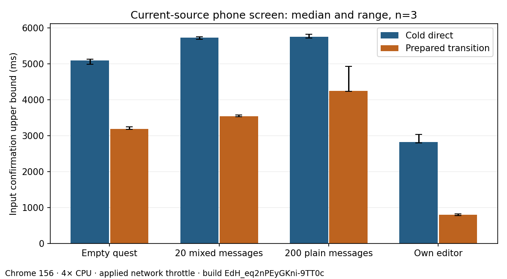

# Workshop prefetch and current quest screen

This local investigation follows [#819](https://github.com/axolotl-logic-io/project-buddy/issues/819) and the remaining [#796 client work](../../796/README.md). It uses synthetic accounts, the guarded worktree database and the mock model. No production data or paid model is used.

## Source and scope

The baseline is integration `957f06d5`. The candidate is `22de8bab`, which disables automatic prefetch only for the Workshop's three kind-tab links. Links retain their addresses, current-page announcement, focus behavior and Next client navigation. Other links retain their prefetch policy.

The branch subsequently incorporates integration through #891. That merge changes conversation accounting and Journal migration code, while the tab mitigation stays unchanged. Runtime measurements here describe the named pre-merge build pair, not a rerun on the merged head. Final CI validates the merged source separately.

The historical #797 cohorts remain unchanged. Their desktop-only burst followed a different main-content dialog on older sources. The current simplified app has removed that dialog, the Adventures list and the Activities destination. Its quest page now contains its conversation; old conversation addresses redirect there. The maintained full audit's route and control matrix has not been migrated to this topology. Its old matrix is not current-app acceptance evidence.

## Discriminating experiments

The initial cohort completes eighteen Workshop observations: three repetitions of each desktop/phone × no interaction/keyboard menu/pointer menu cell. Each uses a fresh browser context and observes five seconds after the selected intervention. These Workshop profiles have no network or CPU throttle. Phone means a 390 × 844 mobile/touch viewport; desktop is 1440 × 900. Both use pinned Chrome 156.0.8078.4 and Parchment Light. This differs from the historical throttled phone profile.

Repeated Workshop prefetches occur without opening a dialog, on both viewports. Dialog close is therefore unnecessary for repetition at this source. The exported categorical paths in this first screen do not distinguish Workshop query variants.

A separate three-repeat link-ablation experiment records two seconds before and two seconds after removing links from the document. Conditions alternate order. Removing only the active Constructs tab leaves repeated Activities-query requests. Removing all four Workshop links stops new Workshop requests in the second interval. All three untouched controls continue requesting. One all-link condition has only one request in its first interval; this outlier remains recorded and is not replaced. DOM removal is a diagnostic intervention, never the shipped implementation.

The query classification retains only `construct`, `activity` or `spell`, never raw addresses or query strings. The repeated destination is the Activities variant. This establishes link-driven speculative work at the current source. It does not establish the internal framework cache defect or explain the historical dialog-dependent desktop/phone difference. The Next 16.4.3 client link code schedules visibility/intent prefetch tasks; no custom product prefetch loop exists.

## Matched tab experiment

The paired capture alternates baseline/candidate order across ten pairs per viewport, with a fresh context for every observation. Both production builds use the same isolated fixture and configuration. Servers run from copied real build directories with the original `next.config.ts`. All costly stages hold `/tmp/project-buddy-unattended-full-suite.lock`; no GitHub wait holds it. Host load accompanies observations.

Each observation opens and closes the shared menu with the keyboard, observes another five seconds, then follows Activities. The driver requires the selected tab, populated definition list and unchanged document time origin. It retains the complete observed request interval; summaries also count only requests started and completed in the first five seconds from navigation. Geometry quiet is not used as a network-completion condition.

Values below are median [min–max], with ten observations per variant and viewport. Byte totals use Chrome DevTools Protocol encoded lengths for all requests started and completed in the first five seconds. They are separate from Resource Timing counters in the input cohort.

| Viewport | Workshop prefetches before → candidate | All completed bytes before → candidate | Activities confirmation before → candidate (ms) |
| --- | --- | --- | --- |
| Desktop | 481 [384–552] → 0 [0–0] | 1,522,885 [1,280,072–1,661,080] → 409,418 [396,207–451,943] | 45 [41–49] → 43 [39–79] |
| Phone, unthrottled | 482 [346–549] → 0 [0–0] | 1,500,592 [1,196,561–1,689,156] → 409,722 [393,669–441,387] | 43 [40–49] → 42 [38–83] |

The candidate has zero completed Workshop prefetches across all twenty fixed-window observations. All forty explicit Activities navigations retain the document and show the selected tab with a populated list. The candidate's slowest confirmations, 79 and 83 ms, stay visible; similar medians do not establish population no-regression. This is a finite-window reduction in redundant speculative requests, not removal of the explicit navigation fetch.

Results are in [summary.json](summary.json). Request and byte reductions here do not establish a reduction in main-thread blocking time. These are medians and observed ranges from ten local pairs, not population percentiles. Disabling speculative requests moves loading to explicit tab navigation. The tab confirmation comparison reports that tradeoff; it must not be described as removal of the route's required navigation requests.

## Current quest and editor screen

The separate input cohort uses three direct and three client-transition runs for each 0/20/200-message quest and own construct editor. It uses a 390 × 844 mobile/touch viewport, 4× CPU slowdown, 150 ms latency, 200,000 bytes/s download and 93,750 bytes/s upload. The 20-message fixture contains Markdown, code, an image and a milestone tool result; the larger fixture contains plain paragraphs. Exact DOM message counts are asserted. Rich-case creation alone does not establish successful highlighting, image delivery or tool accessibility.

Client navigation starts on Quests, or Workshop for the editor. The maintained source-menu readiness probe confirms hydration before activation. The unchanged document time origin is required. Direct timings start at navigation; transitions start immediately before link activation. The source-menu preparation warms shared code and prefetches, so these are prepared transitions, not an unprepared first click.

The 42-character input probe records attempts and confirms Send enabled or a stored editor draft, at 100 ms lab sampling resolution. Confirmation includes typing, state updates and automation; it is an upper bound, not an exact hydration timestamp. Long-task overlap and completed Resource Timing transfer use the first five seconds from the appropriate origin. Full task/resource arrays remain available. Keyboard observations include presentation delay and may omit events below 16 ms; an absent event is not zero latency. No field INP claim follows. This screen records neither scroll anchors nor layout-shift attribution; it cannot establish reading-position preservation or CLS.

Three separate controlled `/mock-slow` replies follow the completed input matrix on the 200-message quest. They run at 4× CPU without network throttling. They mutate only the isolated fixture, retain no message text and require the history count to increase by two per reply. Their observation starts at Send and ends when Stop reply disappears. They are not pooled with initial-load work.

Input confirmation below is median [min–max] in milliseconds, with three observations per cell on candidate `22de8bab`, build `EdH_eq2nPEyGKni-9TT0c`.

| Journey | Cold direct | Prepared client transition |
| --- | --- | --- |
| Empty quest conversation | 5,094 [4,988–5,135] | 3,184 [3,173–3,244] |
| Mixed 20-message quest | 5,726 [5,687–5,759] | 3,540 [3,525–3,575] |
| Plain 200-message quest | 5,753 [5,719–5,829] | 4,243 [4,235–4,927] |
| Own construct editor | 2,821 [2,802–3,031] | 792 [766–821] |

The empty conversation remains slow, so history size alone cannot explain the startup cost. These observations miss #796's conversation cold and transition input targets. The editor meets its candidate input ceilings in this screen; three observations do not confirm a general improvement. Controlled reply durations are 8,698, 8,697 and 8,661 ms, including the mock's configured delays, rather than eight seconds of CPU work.

This is a current-source screen, not a before/after renderer experiment. It does not revalidate the historical renderer gain. There is no React profiling build or causal hydration attribution, no new font/media experiment and no windowing. The prior rejected splits, renderer alternatives and inaccessible bounded-history experiment remain in #796's archive.

## Failures and remaining acceptance

[failures.json](failures.json) retains five failed/cancelled preparation or partial capture attempts. A pre-hydration native navigation, an unconfirmed single keyboard action and a copied server missing its configuration all fail the driver. Corrected protocols have distinct names; their observations are never pooled with failed partial cohorts. No passing repeat erases a failure.

#819 remains open: the current Workshop mitigation does not resolve the older quest Journal-link observation, establish the internal framework cause, or explain the old dialog onset. The next discriminating experiment needs the named old build with query categories and link/visibility interventions, matched desktop and throttled phone controls, including the old quest Journal link. It must preserve the historical observation windows.

#796 remains open: three-run current-source screens do not confirm a ten-run improvement, shared startup targets, earlier-reading/scroll behavior during replies or the complete rich-content acceptance. A candidate for the remaining conversation bootstrap needs matched profiling and regression evidence. Physical-device or field evidence would extend lab scope, but is not the reason this implementation acceptance remains incomplete.

## Artifact checks

The archived recipes describe the executed local driver, including failed versions and serving repairs. The reducer validates a closed vocabulary of categorical strings, numeric values and known fields, reads the written gzip files back, rejects six privacy/nonfinite negative cases, verifies matrix completeness and checks the candidate's fixed-window prefetch bound. Artifacts retain no cookies, credentials, raw addresses, request identifiers, headers, private ids, content, selectors, stacks, DOM snapshots or screenshots. Private fixture files are removed and the guarded database reset after each run. Recipes contain selectors and fixture text, while observation artifacts do not.

## Validation

The candidate passes the fast check (338 tests in 64 files). After merging integration through #891, the fast check passes 342 tests in 66 files, and the two affected Workshop browser files pass 52 cases across Chromium and WebKit. The production diagnostic validator accepts all compressed artifacts, verifies forty paired rows, twenty-four input rows and three controlled replies, and rejects six negative privacy/nonfinite cases. The matched request bound passes. These focused local checks do not replace the final head's four CI jobs.
