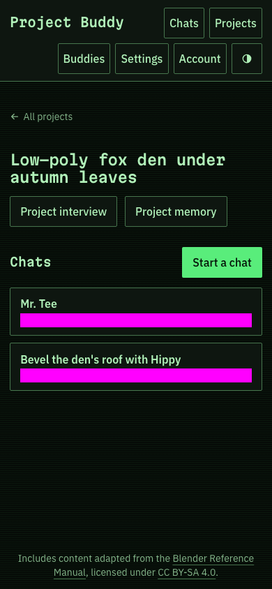
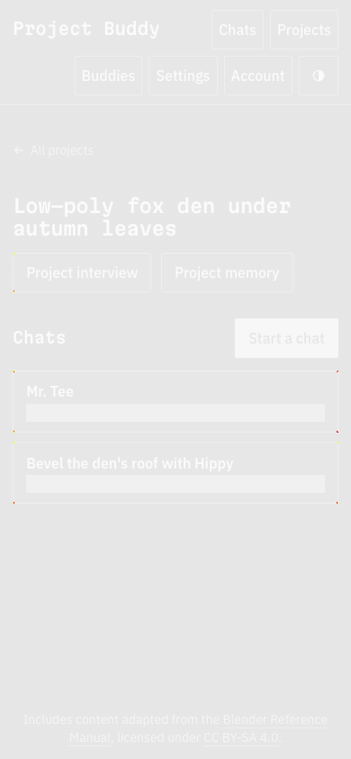

# Rounded-border rasterization in issue #506

## Cause

Chromium's partial rasterization produces different rounded-corner colours when it repaints a clipped region rather than a whole tile. The Ay, Liens! project page at 390 px has fractional card positions. Repainting its masked timestamps can change pixels at the corners of the cards and the interview button, even though their geometry and colours have not changed. Waiting for stable screenshots does not distinguish these two settled renderings.

The diagnostic changed the text inside the existing timestamp masks. Before the fix, the before/after images differed at 32 raw RGBA pixels, with colour channels changing by one or two levels. The screenshot comparator counted 12 differing pixels against the old baseline, reproducing the reported failure. The differences are outside the timestamp masks. Font loading, date glyphs escaping the masks and layout movement do not account for them.

Disabling the GPU did not fix the repaint regression. Chromium reported software rasterization in that experiment. Disabling partial rasterization with `--disable-partial-raster` made the before/after PNGs byte-identical. This setting makes Chromium paint whole tiles for visual tests. It does not change the site's CSS, mask another area or increase a tolerance. The auth project and WebKit keep their normal settings.

The original run's diff was not retained, so its exact paint history cannot be recovered. This diagnosis reproduces the same 12-pixel failure and provides a regression that fails without the rasterization fix.

## Baseline review

Only `project-ay-liens-dark-390-darwin.png` needed regeneration after the rendering change. The other 319 existing visual comparisons passed unchanged. The new baseline records whole-tile rasterization deliberately; it is not a selection of a passing partial repaint.

The table retains the previous baseline, the regenerated baseline and Playwright's diff for independent review. The new image is also committed at the [approved-baseline path](../../../apps/web/e2e/visual/project.spec.ts-snapshots/project-ay-liens-dark-390-darwin.png).

Independent hardening review compared these images side by side and inspected enlarged corners. It found only the rounded-corner changes described above, with no layout, text or mask changes to flag. The retained old image matches the base branch's baseline, and the retained new image matches the committed baseline byte for byte.

| Old | New | Diff |
| --- | --- | --- |
|  |  |  |

## Regression and validation

`project.spec.ts` also compares the complete PNG before and after repainting the existing masked times with shorter text. It requires byte equality, with no pixel allowance. Both PNGs are saved to the test's output directory, and attached on failure. This test checks the screenshot measurement, not a new product behaviour.

With an orchestrator-supplied, migrated test environment, run these commands from `apps/web`:

```sh
npm run test:playwright -- e2e/visual/project.spec.ts --project=visual \
  --grep 'project-ay-liens-dark-390|rounded borders' \
  --repeat-each=20 --workers=4 --retries=0
npm run test:playwright -- --project='visual*' --workers=4 --retries=0
```

The focused command runs each of the original comparison and the repaint regression 20 times with four concurrent workers. It does not allocate extra lanes. Multi-lane validation requires separately supplied lane checkouts and environments; do not share a lane's database, site port or build directory between independent runs.

Independent hardening validation confirmed:

- The focused command passed all 40 tests with four workers and no retries.
- A diagnostic configuration that omitted only `--disable-partial-raster` failed the repaint regression on its first run. The before/after images differed at 32 raw RGBA pixels. The normal configuration and baselines were not changed for this negative control.
- All 321 tests in the visual projects passed without baseline updates, including the repaint regression and the 320 existing comparisons.
- The [configuration tests](../../../apps/web/test/scripts/test-db/playwright-config.test.ts) passed. They check that desktop and emulated-phone Chromium visual projects use whole-tile rasterization, while WebKit and auth retain their original device settings.

These runs used one orchestrator-supplied lane. They establish concurrent-worker repeatability, not separate-lane validation.
