# Supplemental review evidence for #680

Behavior commit: `19fa8293dcd28c714a5137b1fae12f6ae45f4a69`. Product UI is unchanged from `423830cea20a748111b4ff1f89a57d3dbea4880c`. Only disposable local fixture data was rebuilt after server validation.

Desktop 1280 × 900; mobile 390 × 844. Actual viewport verified after navigation. Shared Chromium preview, mock buddy, file outbox. Hidden-tab animation-frame shim and React streaming flush used. No touch, zoom or screen-reader claim. The Next development indicator is visible in some captures. All addresses and content are disposable local fixtures.

## deleted-desktop

Spell deletion destination displays the focused deletion notice and retained-chat instructions rule. Desktop was revisited after the actual mobile deletion; the image alone does not prove focus.

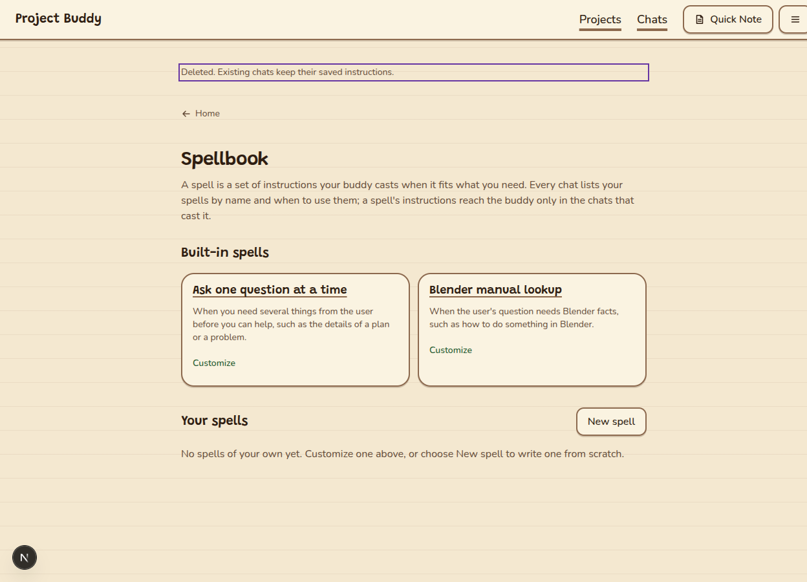

## deleted-mobile

Spell deletion destination displays the focused deletion notice and retained-chat instructions rule. Desktop was revisited after the actual mobile deletion; the image alone does not prove focus.

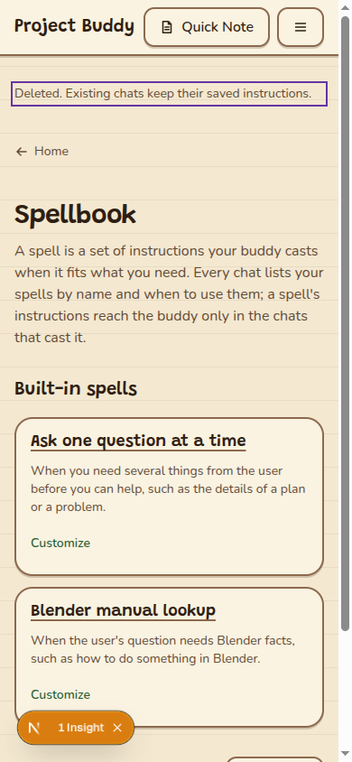

## invite-confirm-mobile

Revocation requires confirmation and explains that the invitation stops working.

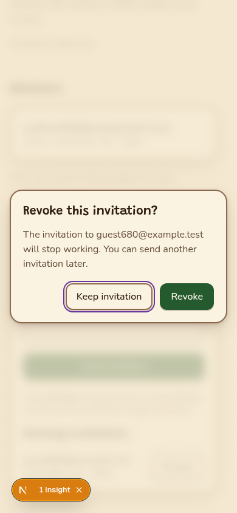

## invite-sent-mobile

Invitation success remains visible beside the pending invitation after the actual send.

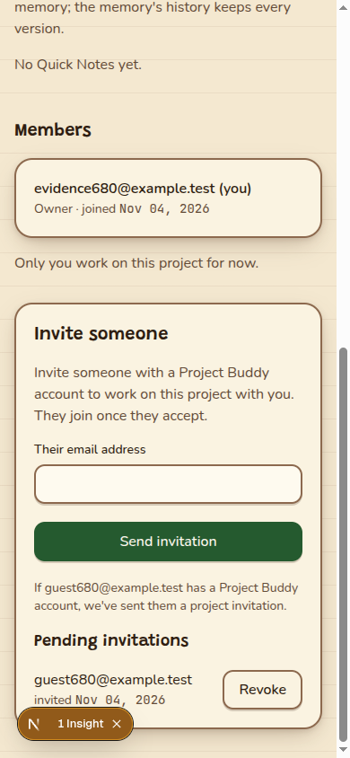

## login-desktop

Sign-in page explains the site purpose and emailed-link sign-in.

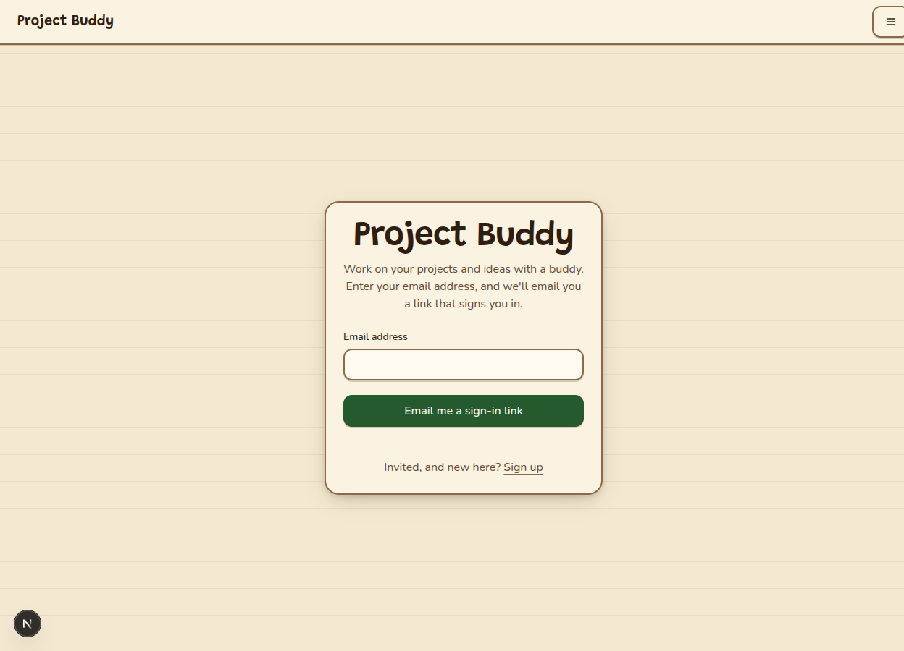

## login-mobile

Sign-in page explains the site purpose and emailed-link sign-in.

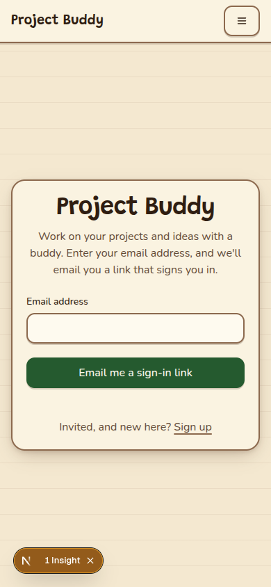

## marketplace-desktop

Prospective buyer sees instructions-hidden-until-copy disclosure beside Buy; this account has no copy.

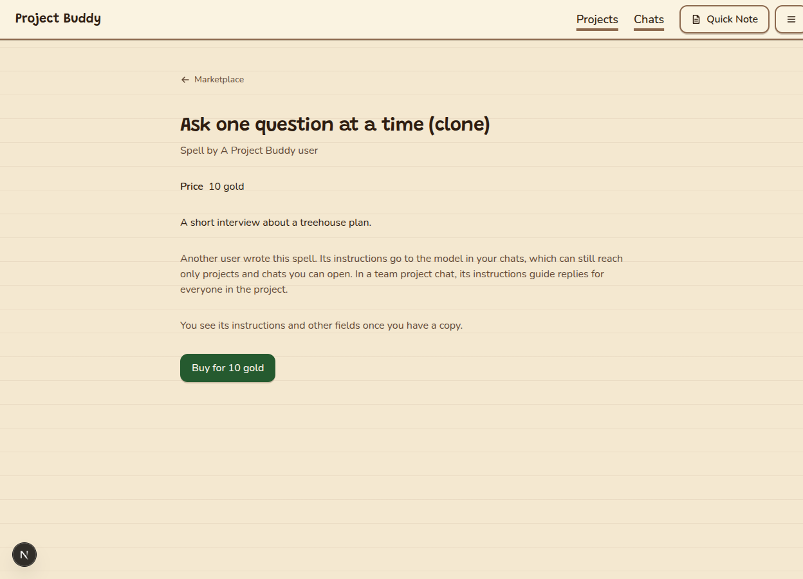

## marketplace-mobile

Prospective buyer sees instructions-hidden-until-copy disclosure beside Buy; this account has no copy.

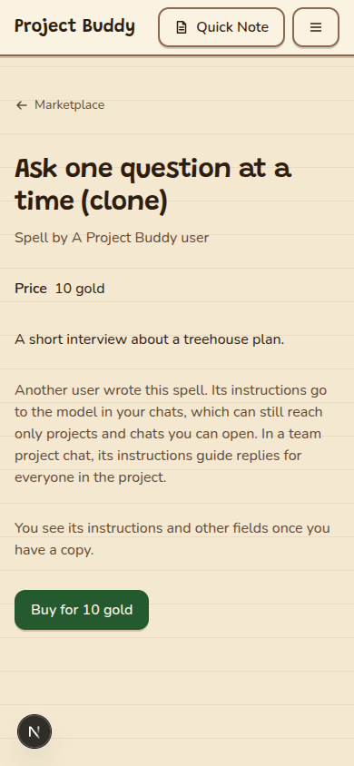

## memory-confirm-mobile

Restore confirmation explains that earlier text becomes a new version and history stays.

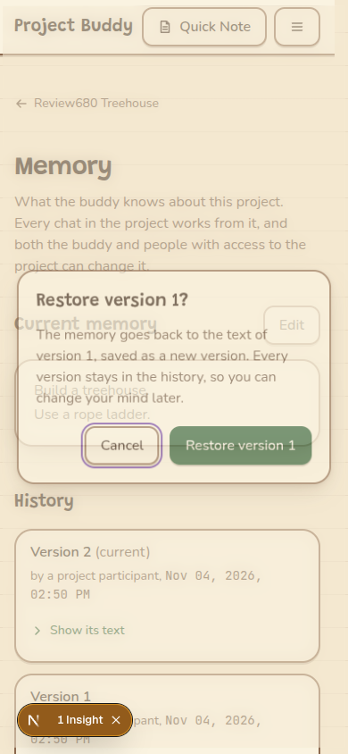

## memory-restored-desktop

Completed restore: version 3 contains version 1’s old-oak text; version 2 remains in history.

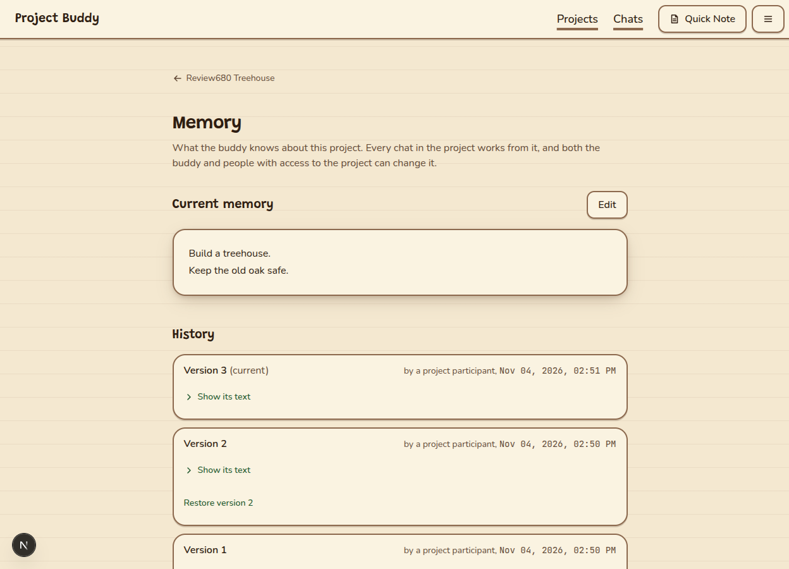

## memory-restored-mobile

Completed restore: version 3 contains version 1’s old-oak text; version 2 remains in history.

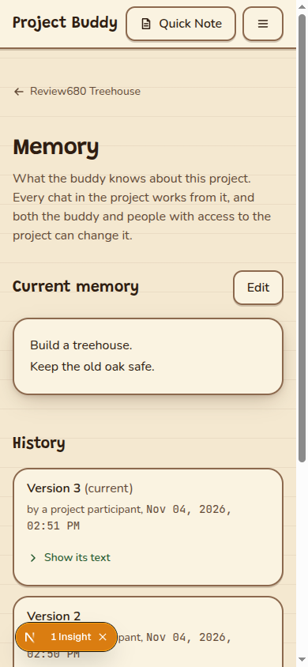

## not-found-desktop

Unknown project displays Not found, explains missing or deleted links, and offers Home.

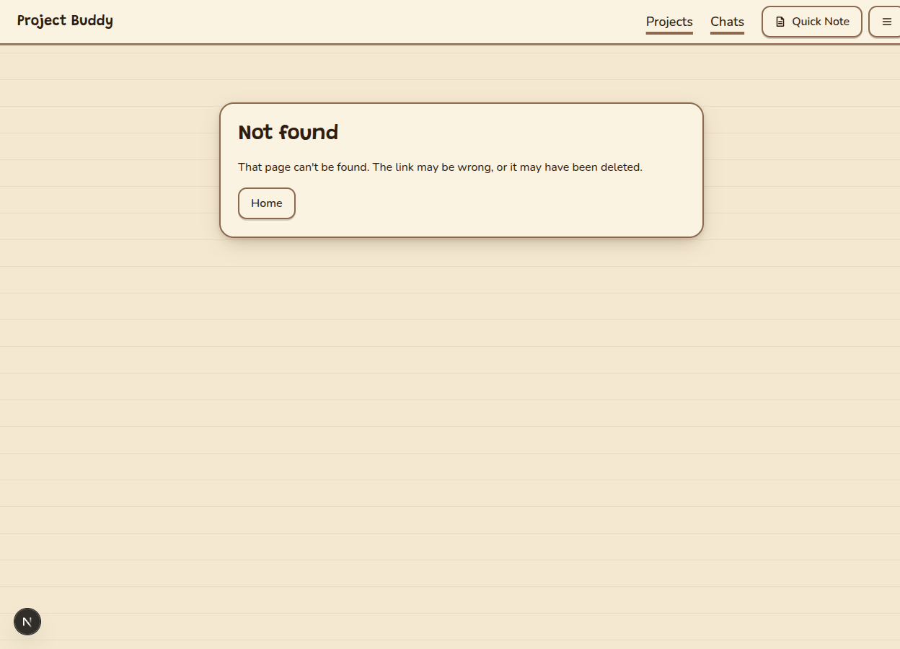

## not-found-mobile

Unknown project displays Not found, explains missing or deleted links, and offers Home.

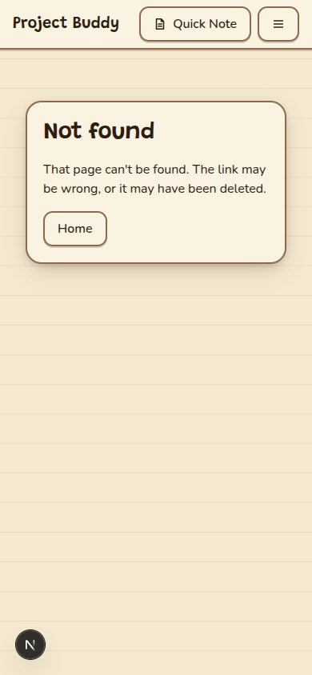

## spell-desktop

Spell editor separates When to use from Instructions and names the combined section correctly.

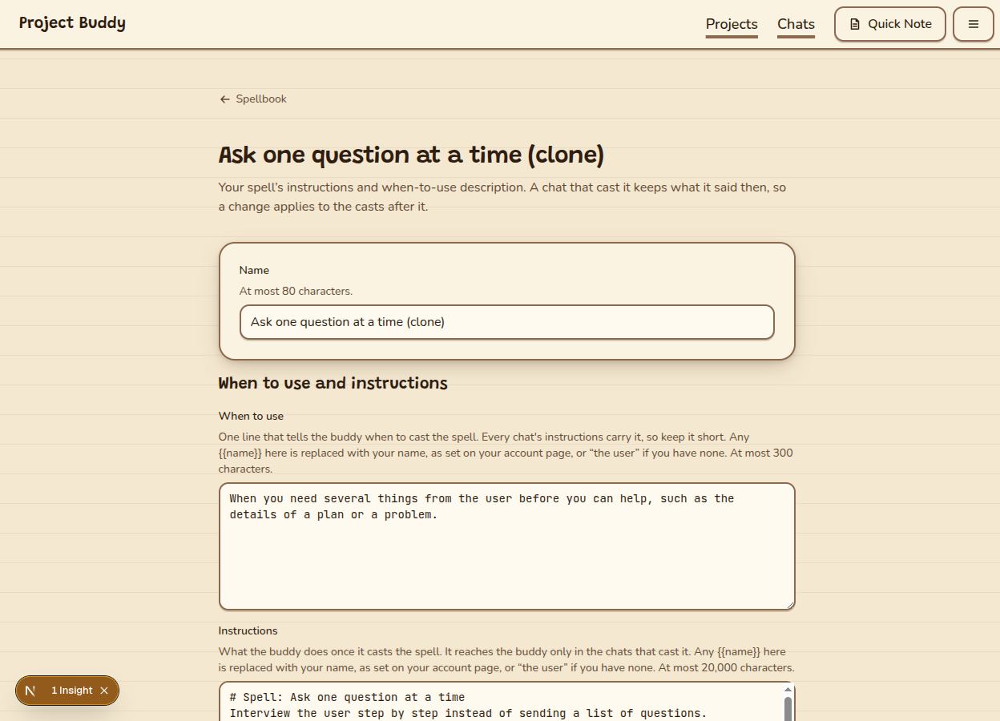

## spell-instructions-mobile

Lower spell editor shows Instructions and its scope to chats that cast the spell.

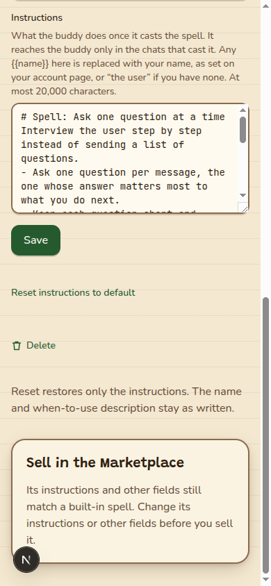

## spell-mobile

Spell editor separates When to use from Instructions and names the combined section correctly.

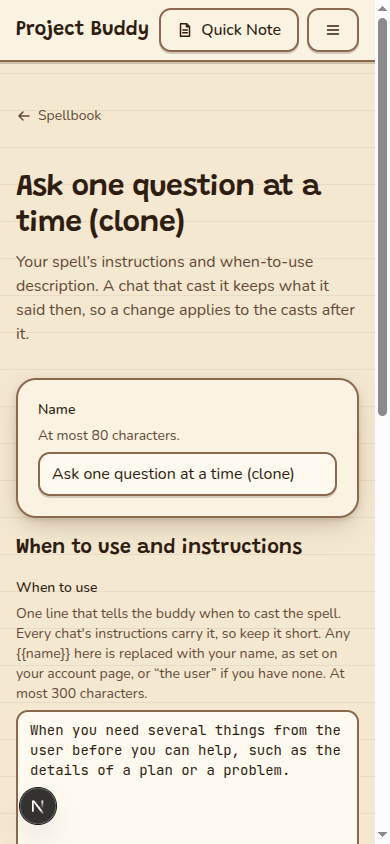

